# Loom Architecture

- 状态：设计基线 / proposed
- 日期：2026-11-16

本文保存 Loom 的长期架构约束、领域边界和不应随实现进度遗忘的设计判断。产品取舍见 [vision.md](vision.md)，分阶段验证见 [roadmap.md](roadmap.md)。

## 1. 核心不变量：分开建模，不等于彼此无关

这里的 `≠` 读作“**不是同一个概念，不能相互替代**”，不表示两者没有关系。
两侧通常有关联，但关联必须显式建立；不能由一方的存在自动推断另一方。

- **身份与授权**：Agent ≠ Host；Worker ≠ Agent；Project ≠ Chat；Discovery ≠ Permission；Capability ≠ Grant。
- **工作与状态**：Assignment ≠ Ticket；Delivered ≠ Read；Unknown Outcome ≠ Failed。
- **展示与记录**：Collapsed Transcript ≠ Deleted Transcript；Visible Transcript ≠ Authorized Resource Access。
- **学习与设备**：Observed Habit ≠ Confirmed Preference；Saved Skill ≠ Standing Grant；Mobile Client ≠ Always-on Host；Device Reachable ≠ Device Trusted。

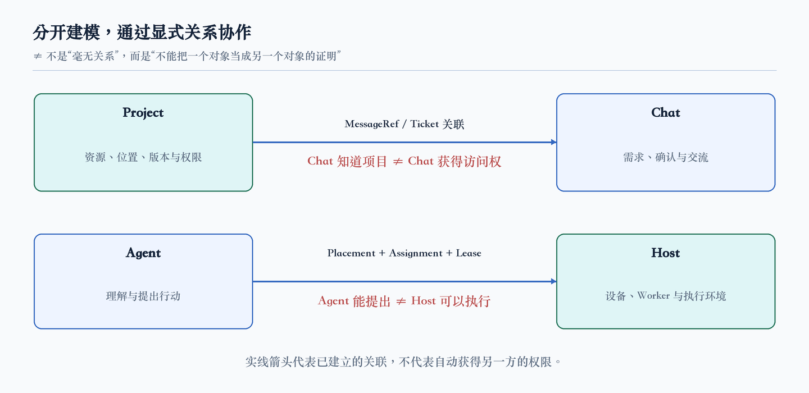

还需要始终保持：**中心是唯一任务权威；执行与数据留在各 Host。**
控制流经过协调器，大 Artifact 尽量直达；只共享路由、授权和必要工作简报。
模型可以提出需求，代码执行 Policy；界面展示、记录保存和资源访问分别判断。
手机或 IM 的自然语言不是系统授权，敏感操作需要明确摘要、近期设备确认，必要时使用平台强认证。
没有合适的执行环境就排队或询问，不虚构工作已经完成。

## 2. 参考方案与 Loom 的选型

参考：[deepseek-ai/dsh-superagent-prototype](https://github.com/deepseek-ai/dsh-superagent-prototype)。
它是研究原型；本文只采用适合 Loom 目标的控制面划分，不把公开设想当作已实现能力，也不评价参考方案本身的架构对错。

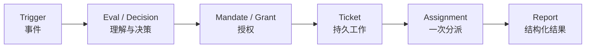

### 2.1 保留的设计

| 机制 | Loom 的用法 |
| --- | --- |
| Trigger / Thread | 统一多端事件身份、顺序和幂等；来源消息不直接取得权限 |
| Policy Gate + Eval | 模型参与意图判断，代码负责准入；记录决定及依据 |
| Mandate / Grant | 授权独立于 Session；扩大范围必须取得新授权 |
| Ticket / Assignment | 工作可以换执行实例；一次执行故障不等于任务终结 |
| Delivered ≠ Read | 输入经过送达、纳入执行、形成报告等阶段，不能仅靠 MQ ACK |
| Durable Effects + Outbox | 先持久化待执行效果，再执行并保留恢复依据 |
| Structured Report / Attention | Worker 提交结构化状态、结果和人工问题，不靠自由文本猜状态 |
| Quiet by default | 只在有结果、需要决策、受阻或有价值进展时打扰用户 |

### 2.2 针对 Loom 目标作出的不同选择

以下都是**针对 Loom 目标的选型适配**：不是哪一方架构有误，也不是对参考方案作全面评价。
这里比较的是 Session、资源调度、隔离和身份等机制；部署位置与模型选择则根据任务、资源、隐私和成本独立决定。

| 选择 | 与 Loom 目标的适配原因 |
| --- | --- |
| Ticket 不绑定本机 DSH Session 或绝对目录 | 中心保存逻辑 ProjectRef / Placement，由 Host 在执行时绑定 Workspace，才能跨环境恢复 |
| 迁移工作上下文，不承诺直接迁移 Session | 跨机传递 Task、Grant、必要 Input、报告、Git 引用和 Artifact，不假设各 Host 的内部 Session 可互换 |
| Resource Scheduler 不交给另一个 LLM | 调度需要可认证库存、权限和确定性约束；模型可以辅助解释，不能凭自述拍板 |
| 不把进程命令 Shim 当隔离 | 公司 / 个人 Worker 同机时由 Host 执行权限，必要时使用独立 OS 用户或容器 |
| 身份不写进提示词映射 | 跨端身份使用已验证的 Principal 与 Device Link，不由模型推断 |
| 不把已有 Effects 当跨机 exactly-once | 使用 Lease、fencing、unknown outcome 和确定性对账处理重复投递与失联 |
| GitHub PR 生命周期留在适配器 | 通用核心只表达 Result、Review、Artifact；PR 终态是 GitHub 的领域规则 |
| SourceKind 与 SourceInstance 分离 | 同类入口可以有多个独立来源，各自拥有身份、游标、Policy 和命名空间 |

参考文档：[Domain](https://github.com/deepseek-ai/dsh-superagent-prototype/blob/main/docs/001-domain.md) · [Authorization](https://github.com/deepseek-ai/dsh-superagent-prototype/blob/main/docs/002-authorization.md) · [Execution](https://github.com/deepseek-ai/dsh-superagent-prototype/blob/main/docs/003-execution.md) · [Architecture](https://github.com/deepseek-ai/dsh-superagent-prototype/blob/main/docs/007-architecture.md)。

## 3. 目标架构

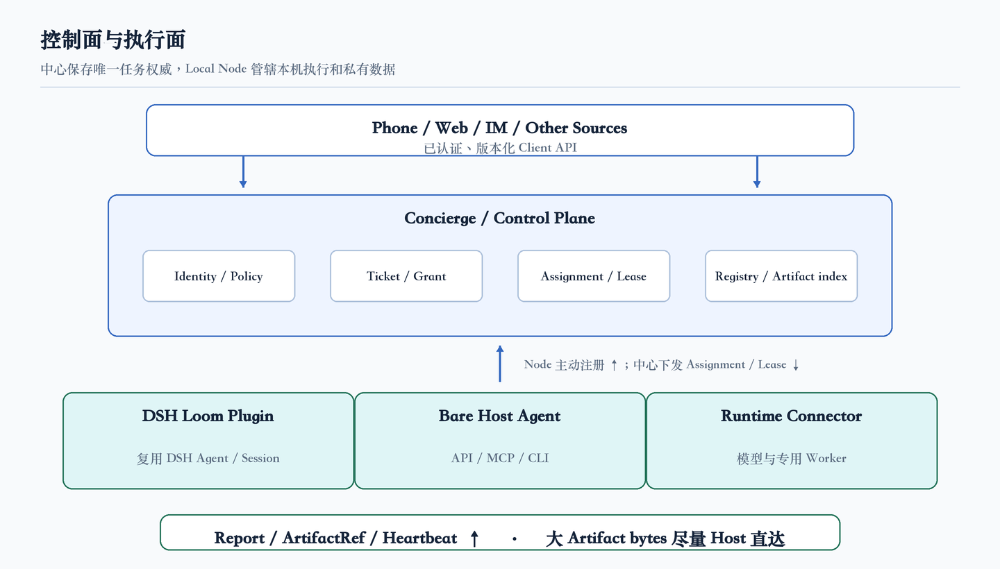

中心负责身份、授权、持久工作和恢复；Local Node 负责执行环境与本机副作用。
节点主动注册，但注册不等于授权。中心不绕过 Local Node 直接操纵远程 Harness，也不汇聚完整 Worker Transcript。

| 关注点 | 中心 Concierge | Local Node / Host Agent |
| --- | --- | --- |
| 主要对象 | Ticket、Grant、Lease、Assignment、Report、索引 | Session、Workspace、Worker、Artifact bytes、Effect Ledger |
| 决策 | Policy、Placement、配额、调度和恢复 | 本机能力探测、执行、心跳、停止与对账 |
| 数据 | 必要消息、Shared Brief、引用与审计 | 原始上下文、私有文件、Secret 和本地运行事实 |

Local Node 分为两种部署形态，使用同一版本化 Node 协议：

- **DSH Loom Plugin**：在 DSH 进程内复用 Agent / Session，提供注册、事件、Grant、心跳、ArtifactRef 和对账；DSH 主机不必再装独立 Rust Agent。
- **Bare Rust Host Agent**：在没有 DSH 的桌面或 Linux 服务器上，通过 Native API / MCP / CLI 管理 Worker 和本机资源。

同一节点声明的模型 HTTP 服务属于它的 Runtime，不必另装 Agent。
Owner、Device Link、Node Identity、Profile Identity 和 Workspace Scope 分别映射，同机不等于同身份或同授权。

### 3.1 设备角色

| 平台 | Client | Host 首版定位 |
| --- | --- | --- |
| macOS / Linux / Windows | Web / Desktop Shell | 有 DSH 时使用 Loom 插件；裸机使用 Rust Host Agent，逐步验证后台服务与开机恢复 |
| iOS / Android | Web / PWA，必要时薄原生壳 | 查看、审批和 Artifact 访问；不是默认可靠的长驻 Host |
| NAS / 服务器 Linux | Web | 资源和权限满足时可作为 Host |

移动设备受锁屏、进程终止、网络迁移和电池策略影响，不自动拥有稳定 Lease，也不靠保活轮询伪装长期执行能力。

### 3.2 四种决策职责

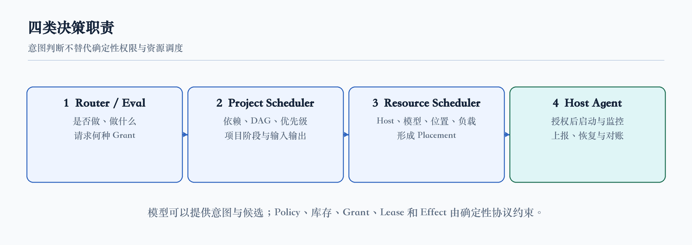

| 组件 | 决定什么 | 不做什么 |
| --- | --- | --- |
| Router / Eval | 是否做、做什么、请求何种 Grant | 不直接执行副作用 |
| Project Scheduler | DAG、依赖、优先级、输入输出和项目阶段 | 不凭空创造资源或权限 |
| Resource Scheduler | 根据 Host、模型、位置、权限和负载作出 Placement | 不由另一个 LLM 凭自报能力拍板 |
| Host Agent | 本机启动、授权、监控、恢复、对账和上报 | 不成为第二个跨机任务权威 |

中心初期采用单写者与事务化存储。库存状态是资源事实，不是行动 Grant；Worker 自称“可以跑”也不是最终资源事实。

### 3.3 如何阅读当前实现

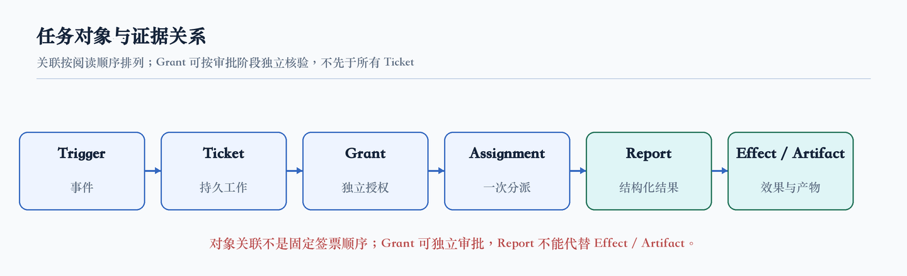

持久 Ticket 及其授权、执行 Assignment、Report 与 Effect/Artifact 各自保留身份。图中对象按关联排列，**不表示必须先获得 Grant 才能创建 Ticket**；Source 可先形成等待审批的 Ticket，审批与 Assignment 分别核验当前 Grant。
每个对象只负责一个事实；核心对象定义收在[附录 A](#附录实现约束与验证记录)。

当前实现围绕**受认证 Source、受限任务、真实 Node 与可核验 Artifact**逐步增长，不代表长期设计中的全部能力都已交付。
每项能力都要同时说明范围、授权前提、外部效果、失败 / Unknown 处置、恢复证据以及尚未覆盖的平台。
实现约束与验证记录统一收入附录；当前开发状态以 [IMPLEMENTATION_STATUS](docs/IMPLEMENTATION_STATUS.md)、[BASELINE](BASELINE.md) 和 [roadmap](roadmap.md) 为准。

## 4. 会话可见性与审计

### 4.1 默认简洁，过程可展开

| 视图 | 回答的问题 |
| --- | --- |
| Conversation | 用户提出什么、确认什么，最终结果是什么 |
| Activity | 任务在哪、处于什么阶段、当前阻塞是什么 |
| Collaboration | 谁在协作、为何委派、交接了什么、结论是什么 |
| Worker detail | 哪次 Assignment 使用了哪个 Session、工具、产物和报告 |

界面支持全局偏好与单任务覆盖：默认折叠、始终展开、只看关键协作或隐藏过程。
**折叠、保留和权限是三件事**：偏好不改变保存的数据；展开、搜索、复制、导出和跨 Worker 引用仍需鉴权。

- 不把所有 Agent / Worker 消息塞进主聊天流，也不把原始 Transcript 当作状态唯一来源。
- MessageRef 记录发送者、接收者、任务关联、来源、可见性和敏感级别；结构化 Report / Effect / Artifact 独立保存。
- 外部 Harness 的内部 Session 通过 Adapter 映射，不要求统一存储格式；读不到完整 Transcript 时明确缺口，不伪造记录。
- 用户可以隐藏或删除自己的过程展示，但这不意味着可以删除尚未完成的 Grant、Effect 和必要审计。

### 4.2 存储与性能边界

中心初期不汇聚全部原始 Worker Transcript，只保存主对话和关键协作消息、有界 Shared Brief、Host 侧受控引用，以及索引、可见性、摘要与审计元数据。
用户展开细节时按需从有权限的 Host 获取；Host 离线就显示“暂不可用”，不把摘要冒充完整原文。

## 5. 记忆、上下文与归档

### 5.1 记忆分层

| 层 | 内容 | 默认行为 |
| --- | --- | --- |
| Concierge Memory | 用户偏好、Agent / Host 索引、授权关系、活跃项目索引 | 长期保存，路由时按需使用 |
| Agent / Worker Memory | 各角色长期规则、项目经验和局部上下文 | 留在所属 Worker，不默认共享 |
| Task Working Memory | 当前约束、阶段状态、错误、局部决策 | 只交给相关任务和后续 Worker |
| Shared Brief | Worker 提交给协调器的结论、证据、阻塞与 Artifact 引用 | 有界、结构化、与权限分开 |
| Cold Archive | 原始会话、日志、旧资料、生成参数和历史版本 | 不主动注入，按需检索和恢复 |

活跃任务约束优先；稳定偏好和长期安全规则不因时间自动过期；被替代的信息标为历史版本。
原始过程进入冷档案，重复中间过程可以淘汰，但未完成承诺、Grant 和审计事实不能由模型自行清理。
记忆可见性不等于资源访问权限，会话折叠也不是记忆清理指令。

### 5.2 从观察到确认

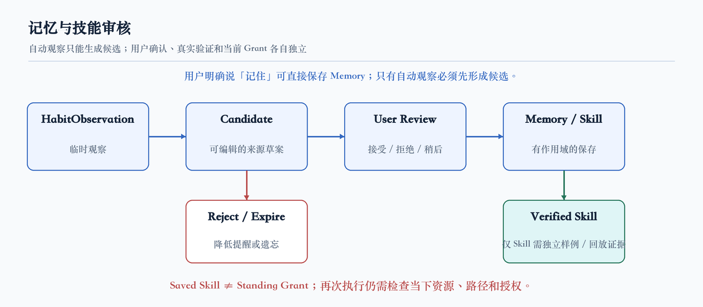

用户明确说“记住”可以保存显式 Memory；自动观察只能形成 HabitObservation / Candidate。
候选要保留来源、作用域和版本，支持预览、编辑、接受、拒绝、稍后处理、暂停建议与遗忘。

- **Memory** 表达偏好和已确认经验；**Skill** 表达可复用的方法，含适用条件、必要输入、步骤、验证、Artifact、来源和版本。
- 接受时可限定全局、项目、Worker 或 Host 作用域，默认最小可用范围；持续操作不能只埋在 Memory。
- Skill 保存后仍需真实测试或样例回放才能标为已验证；保存不等于执行，运行所需的资源、模型和副作用权限逐次由 Grant 决定。
- 新的明确指令优先于旧习惯；冲突必须询问，不能因“用户经常批准”推断永久授权。
- 拒绝可以降低提醒频率，但不被重新解释为另一项长期偏好；候选与审核有审计，普通日志不因此无限期保留。

## 6. Resource、Project 与 Model Registry

### 6.1 资源事实与项目位置

Host 自报硬件、目录、Worker 和在线状态；Controller 可以实测服务与队列；用户声明隐私和无人值守政策；历史记录提供冷启动与耗时。
四类来源分别标记，未知、离线、超时、不支持、拒绝和缺失不能合并成一个“可用 / 不可用”。

Project 必须区分 **Canonical Remote、Working Tree、Generated Workspace、Credential Location**。
优先复用已授权工作树；保留未提交修改；并行修改优先使用独立 Worktree。
Clone 是独立操作，知道 Git URL 不代表自动 Clone；凭据留在本机 Broker，本机绝对路径也不作为全局 Artifact URI。
当前 Git 探测只读取获批项目根中的 Git 事实与 dirty state，剥离 URL 凭据，见[验证边界](tests/projects/README.md)。

Worker声明也不能以同ID、互相冲突的不同对象覆盖。Heartbeat tips为对象数组时可表示暂無 worker，但每个非空条目有唯一的有界`worker_id`，兼容原`id`别名；如果两别名同时存在且不一致，或一个worker_id重复、缺失、非字符串、含控制字符、超过长度，heartbeat必须400且不刷新现场。`validate_heartbeat_workers`让多个自报version不会被当作一次合法合并。一个合法id alias随后在公开inventory按既有翻译解析为worker_id，这不需要新的schema。

进入heartbeat更新之前，Node身份认证之外，只能接受 `online|busy|degraded|offline` 这些实际string状态，缺省按原语义视作online。显式null、非字符串、以及诸如`revoked`之类的伪造状态都返回invalid request，不能直接更新当前row/worker/inventory/时间；仅有合法身份不会使噪声自动进入在线历史。真正撤权仍由中心 `revoked_at` 事实驱动，不能用Node text来替代。

`online/freshness` 是 Controller 在每次读取注册Node时，基于末次认证 heartbeat、撤销事实和当前时间计算的快照；`status`/last_heartbeat 是不可随意重写的原始历史及自报。Vue中的`nodeOnline`尊重这个显式`online=false`，不能因过去`status:'online'`而继续展示在线，也不得以其隐式撤销任何Grant。`revoked_at`必须与陈旧心跳分别表达，末次绝对时间保留；缺失online字段才由已有90秒启发式回退，未对网络/主机进行新探测。真实stale→card/顶栏/resume的proof见 [node presence](tests/model-inventory/README.md#actual-stale-heartbeat-presentation-and-exact-installation-boundary)。这类读取与物理设备离线/断网/多机交接不是同一契约，也不代替Host runtime耗电/重试。

同一公共Node ID能够绑定多个Installation/Profile/Worker，所以设备卡片的VNode key并不能只用Node ID。`nodeIdentityKey`以 `node_id ?? id` 与`installation_id`合并提升真正的安装身份，DOM以`data-installation-id`定位；它不代表多安装共享调用凭据或合并namespace，原来的metadata/旧无Installation记录仍按原字段降级展示。各安装自己的presence/最后heartbeat因此不会借共同Node ID与其它安装互换。已有两次真实注册、只变B末次时间、同库/端口/token重开、新旧B/A bindings全程验收见 [installation driver](tests/browser/installation-ui.mjs)，这两者是logical installation而非新物理机器。

### 6.2 模型生命周期

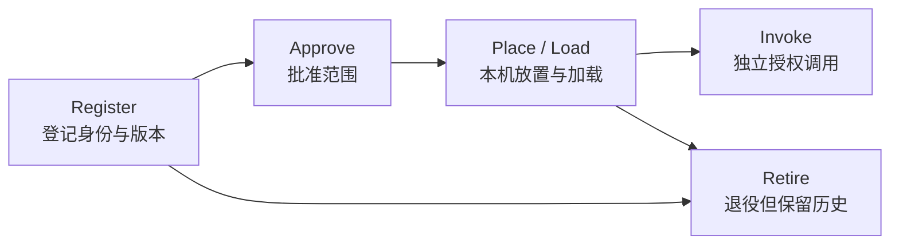

Registry 管模型元数据、适用环境、可用范围和放置计划；Host 管实际权重、加载和调用。
私有模型可以声明 `no-copy`、`local-only` 或 Host 专用；下载、上传、迁移与调用分别授权。
权重不进入提示词或普通事件记录，结果保留模型、LoRA、参数、Revision 和执行环境。

## 7. 技术栈与 Harness 接入

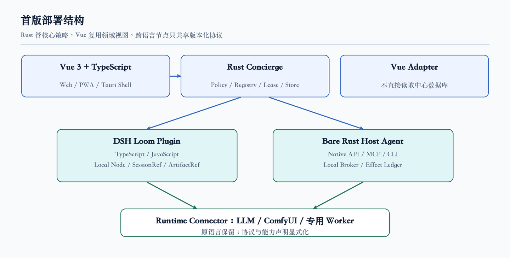

- **Rust**：Concierge、Bare Host Agent、Registry、Policy、Lease、任务状态机和持久化应用层；共享核心模型，但不把私有 Rust ABI 当公共协议。
- **Vue 3 + TypeScript**：共享 Web / PWA 领域界面；桌面优先 Tauri，移动端先 PWA，需要系统能力时再使用薄壳。
- **多语言边界**：DSH 插件保持 TypeScript / JavaScript；已有模型服务和工具保持原语言，通过版本化 HTTP、MCP 或受限本地 RPC 通信。

首个开发基线是 macOS 单用户任务闭环，再逐个验证 Windows / Linux Host；同一套领域模型不等于相同 DOM 和权限可以原样跨平台运行。
Rust 的选择价值在单二进制、资源和本机策略执行，不消除 OS 差异；具体 crate 由原型选型确定。

### 7.1 Adapter 按能力选择

| 接入方式 | 使用条件 | 部署位置 |
| --- | --- | --- |
| Native API Adapter | 已有任务、输入、取消和状态查询 API | Host Agent 旁的独立进程 |
| MCP / Tool Adapter | 标准工具或配置连接已覆盖必要行为 | Host 本地服务或 Harness 配置 |
| CLI / Process Adapter | 只能可靠启动和观测进程，且产物边界可确定 | Host Agent 的受管子进程 |
| Host Runtime Plugin | 确需 Session 事件、细粒度取消和进程内状态 | 对应 Harness 进程 |
| Runtime Connector | LLM、ComfyUI 或专用 Worker | 与 Harness Adapter 分离 |

Adapter 显式声明 `register / submit / interrupt / resume / events / artifacts / transcript` 等能力，未支持项显示缺口。
DSH 的 MCP 只提供工具接入，不能代替 Assignment、取消、Lease 与恢复语义；DSH 插件复用宿主可恢复的 Session，不制造私有缓存权威。

### 7.2 主动注册与中心权威

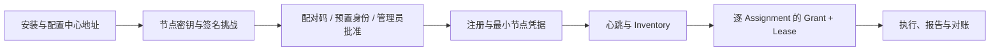

节点主动出站连接中心，中心与节点相互认证；不要求中心直连 Harness 管理端口。
连接、注册和能力声明不自动产生 Membership、目录访问或任务 Grant。
DSH 的多个 Profile / Agent 可以是独立 Worker 命名空间，中心保留跨机任务权威；断线、Token 撤销和协议不兼容时，节点不盲目清空或重做。

## 8. 选择性分发与安装

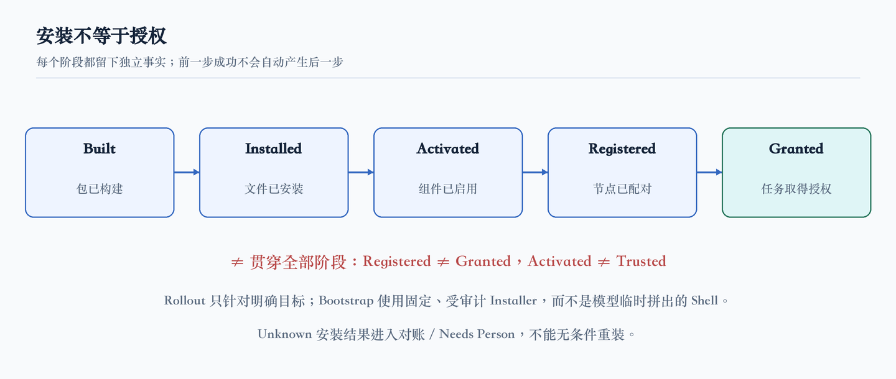

用户可在管理设备构建或下载受批准包，再向选定 Host 创建 Rollout：选择目标、审批包和版本、传输、兼容检查、授权、安装、激活、健康检查与报告。
失败进入显式回滚或 Needs Person，不能把 Unknown 当成失败后盲目重装。

新 Host 可手动安装，或经用户明确授权的 Ansible / SSH / MDM Bootstrap 纳入。
免密只说明已有运维授权，聊天 Grant 不变成远程 Shell / sudo 权限；只允许固定、已审计、有版本的 Installer。
已有 DSH 的 Host 安装插件，无 DSH 的 Host 安装 Bare Agent；注册以后仍需配对和逐任务 Grant。

### 8.1 包与权限

Package Manifest 至少包含不可变版本、摘要、签名、组件类型、OS / arch、宿主版本、依赖、所需权限、声明副作用、默认禁用状态和健康 / 回滚要求。
Rollout 逐目标保存包版本、期望状态、安装 Grant、超时、重启许可和回滚版本。

- 管理机拥有凭据，不代表可把凭据复制到所有 Host 或交给模型；私有模型、Memory、完整会话不随安装包扩散。
- 跨用户、公司 / 个人 Worker 和不信任网络不默认共享 Rollout；安装包的自述不能决定可信性。
- 签名包、版本锁定、逐 Node 批准、健康检查和旧版保留是基础要求；普通聊天不触发跨不受信网络安装。
- 包按 `darwin-arm64`、`linux-x64`、`windows-x64` 等 Target 构建，示例不等于已支持；交叉构建和签名由受控 CI / Build Host 完成。
- Windows 服务、macOS LaunchAgent、Linux 用户服务、ACL 与系统凭据库分别适配；Host 更新与中心迁移不绑成一个不可恢复步骤。
- Web / PWA 静态壳与业务权限分开更新；桌面和系统签名包不静默更新。iOS / Android 不接收通用 Worker 包，也不因页面曾打开就具备后台执行能力。

本机现有 Bare / DSH bundle 证据仅覆盖明确的隔离场景，见 [BARE_PACKAGE](docs/BARE_PACKAGE.md) 与 [BUNDLE_LIFECYCLE](tests/harness/BUNDLE_LIFECYCLE.md)。

### 读取投影作为真实私有实现，不把错误或内部列变成公开结构

schema 16 升级后的旧记录保留原始 Grant/Ticket/Artifact SHA、原字节和原审计。`read_evidence:null` 仅表示旧行没有可继承的**新reader投影**，不复制新授权或重任务。

对Ticket详情与Artifact下载，损坏/不兼容的reader记录经 `public_read_projection` 给出通用错误，不把/storage列名或私有_error text回显给客户端。相应的SQL行转换失败也不把 `_json`字段或原始存储错误吐出。缺少合法旧投影照旧返回null，拒绝既有grant时的authority未改变；实文件bytes与SHA不匹配仍然是 `artifact_integrity`，而不是一种新证据升级。无凭据继续401，不能把读错误写成任务的Unknown或新执行结果。

新增迁移验证既有v15的project/grant/ticket/file/audit升级到16后的真实protected Axum detail与base64读取：无凭据返回401，非法`read_evidence_json`和JSON对象不当申明被400拒绝，非原生JSON/Schema处理不足不成为新Namespace对象。后续bytes变质由integrity gate409拒绝，原nullable字段/row/bytes恢复后仍可核。此为资源读取与隐私兼容缺陷修复，不是整体M0完成、全Host产品的版本迁移或新device/Profile验收。详见[迁移后真实读取](tests/harness/SENSITIVE_READ.md#schema-15--16-migration-through-the-protected-read-endpoints)。

同一出口的`code_evidence_json`也由`public_code_projection`保留change/verification严格校验、私有列移除与双证据冲突，非法旧对象以bounded public错误返回而不泄漏/storage列及其候选值。v13迁移验证在`NULL`合法基线上另行注入非NULL坏候选验证拒绝，再恢复NULL；合法空投影原文仍会成功读取，不能拿初始合法200误称泄漏证明。原Grant/row/原byte/audit均不变。

公开字段扩展还会影响UI证据namespace：code/legacy Artifact可以带 `read_evidence:null`。客户端在分派前区分null/absent与真正的readerproof；缺失不进入reader验证，避免把合法的代码Effect误判为不完整。真正的非NULL reader候选仍按原有公开结构、来源与bytes检查。原始SQL Report只有`state`；`ticketFrom`会派生客户端status，纯函数也支持同assignment唯一Report的state-only，但两个状态矛盾仍拒绝。显示diff或verification时使用这个已核验Report，不倒选父Artifact、借用另一Attempt或把Ticket终态改写为旧Attempt结果。真实Edge的旧失败→新Attempt验收见 [CODE_TASK](tests/harness/CODE_TASK.md#real-nullable-projection-compatibility-inside-the-client)，没有新增Artifact、Grant或执行权。

## 9. 授权、调度与可靠性

### 9.1 Grant 与 Lease 分离

| 对象 | 回答的问题 | 变化的影响 |
| --- | --- | --- |
| Grant | 用户允许哪项工作用哪些资源和操作 | 撤权阻止新执行，使旧 Lease 失效并 fencing 后续写入 |
| Lease | 协调器允许哪个 Host 在什么时段执行哪个 Assignment | 忙碌、离线或过期是执行资格变化，不扩大用户授权 |

Grant 和 Lease 分别版本化。Assignment 至少关联 Ticket、Grant digest、Placement、Project / revision、Lease epoch、attempt、deadline 与 reconciliation。
ACK 表示准入，不是 Report、完成或取消完成；换机是新 Assignment / Attempt，不延续旧机器的本地 Session 假设。

### 9.2 Effect 与 Unknown Outcome

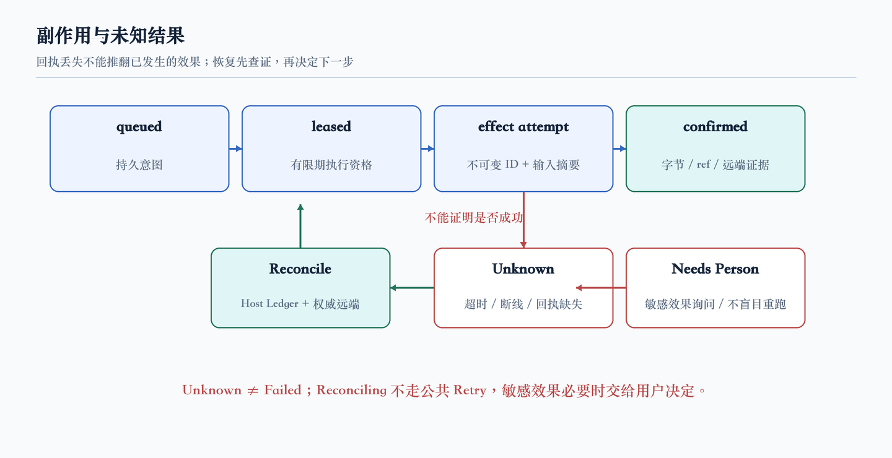

跨机采用 **at-least-once + 对账**，不承诺无法证明的 exactly-once。
不可合并的副作用有不可变 `effect_id`、输入摘要、执行 Host 和证据。断线后先查 Host Ledger 或权威远端：Git 查 ref / commit，文件查原子替换与 hash，外部平台查幂等键，生成任务查任务 ID 和 Artifact。
无法证明结果的敏感效果先对账并询问用户，不盲目重跑。

- 无符合 Host 就排队或询问；Host / Worker 失联与 Ticket 终态分开。
- 公共 Retry 只用于明确 `failed` 且无停止意图的 Ticket；Unknown / Reconciling 先核对现场。
- 人工审批记录决定、理由、原有 Grant / Source、实际 Assignment / Lease 与审计；接受回执不是永久幂等授权。
- 停止是持久意图，自动恢复不能覆盖；Watchdog 检查进展、Lease 与副作用，不只检查进程是否活着。

## 10. 用户交互与 Worker 放置

保持单联系人体验，同时提供 Chat、Activity、Collaboration、Fleet、Project / Artifact、Memory / Access 六种视图。
用户不必每次选机器，但新 Agent / Worker、新项目或敏感目录、本地模型、多机成本差异和长期无人值守任务需要明确选择。

常规任务沿用已保存的默认规则，冲突、成本或权限变化时重新询问。
移动端展示、审批和回到历史 Ticket 不等于后台 Host 能力；任何支持声明仍以目标平台上的真实验证为准。

---

## 附录：实现约束与验证记录

以下为现有受限实现的精确约束、事务边界和验证证据，不是“所有能力均已完成”的声明。
附录保留了原文的标题编号，便于已有链接与开发记录追溯；阅读当前架构时以主文为准。

<details>
<summary><strong>0. 协议对象与边界补充</strong></summary>

## 原 3.2 Bare 重放与精确 Installation

**Bare Rust 完成证据的重放不能只认Assignment ID。** 已有completion/未决outbox只可在poll中的packet重新通过显式ProjectBinding、Grant/binding/lease/root及完整Assignment decoder检查后使用。`StateStore::start()`再把当前输入与历史immutable logical digest（ID、lease ID/epoch、grant digest、kind、relative path及content）比对。它负责重放同一个工作输入，不是把动态lease timing写进digest，或以新Grant/epoch重贴旧Execution的证据标签。精确匹配已有完成时保留原outbox request/effect/artifact标识，不再次执行，也不因再见到取消帧而生成新报告。输入不匹配、完整decode失败或completion缺digest都fail closed；不能用通用reject路径覆盖原Assignment/completion和未完成证据。该约束可经 `cargo test -p loom-node --test completed_replay` 复核。测试用真实原生源文件读取及持久化、受控制的loopback协议transport，明确不把Synthetic poll/Grant说成Concierge签发；普通真实Concierge/Bare签署、读写、取消和重开须再以原生集成验证。这里不推导全局Exactly-once、OS进程崩溃回放或其它Harness的权限。

**Native Rust普通ACK响应不再仅以HTTP 200判定准入。** `acknowledge_envelope` 要求响应中 `accepted:true` 与非空、≤80字节的合法RFC3339 `acknowledged_at`，而不把缺时间、坏时间或accepted:false当中央准入。新完成的normal/successful作业在这些事实有效之前返回Deferred，保持原本outbox而不把它交到别处；`last_assignment_id` only after valid accepted receipt。其后同一次原Assignment的completed replay，仍先通过当前Grant/Binding/root/epoch/deadline与logicaldigest验证，再重试普通ACK，然后原样重发outbox，不再次执行本地file operation。concierge的dup返回原timestamp与唯一绑定audit，重复nonce不是新grant。这是post-effect问题，**要与DSH bundle的执行前普通ACK流程和direct cancellation_observed路径分开**，不可把native suite的controlled loopback扩展称为物理网络断线实例。真实concierge普通文件读写及实际ACK的 `node scripts/bare-integration.mjs` 继续作为对应正例；其它bundle各自独立的proof不能被该Native逻辑替代。启动时的outbox flush仍由既有授权lease场景验证，不宣称对任意未知旧outbox提前重诊赋权。

**Bare持久outbox中的调度时间不能使未投递证据被算作已投递。** 对每个排队项，只有普通有效RFC3339时间可参与比较；明确的quarantine hold `+999999999-12-31T23:59:59Z`由StateStore统一保留为未来不发送。任何其它不可解析的字符串在任何Artifact/Report发送尝试前产生显式调度错误，保留原item/body/attempt和光标等待operator对账，**不将此字符串随机解释为现在，也不把正式hold重写为新状态或权限**。这一个坏项会阻止该次dispatch中的所有投递，是显式保真优先于继续不区分地发其他项的选择。真正不可重试HTTP拒绝继续Reject ed，可重试等待保持Deferred；存在future /hold但未再次投递的内容同样Deferred，只有队列真正没有未投递内容时才可能是Delivered。缺失、null、数字及其它非字符串时间后续也已在StateStore open阶段显式拒绝，不再伪装成`now`，并保持原raw file未写；Bare v1自始就序列化此字段，尚未发现必须兼容的无字段旧格式。这只是显式结构与时间校验，不能据以宣称任意损坏文件均有完整验证、自动恢复或全球调度正确。

**ProjectBinding必须归到精确、可用的 `(Node ID, Installation ID)`，不能只按Node ID取第一条记录。** `POST /project-bindings` 只有在单个未撤销Installation时才可省略`installation_id`保 留旧调用；多个可用安装而缺少选择返回409 `exact_installation_required`。可选参数是非空、非空白、≤160 UTF-8字节的字符串；`null`/数字等400，不存在的Node或指定Installation 404，选中已撤销记录403。选择之后仍要求该**选定记录**的未撤销状态、worker声明和实际project-root自报一致，绝不按哪个root碰巧相符来推断身份。单Installation的旧绑定/读写路径不变。这里的“可用”仅未撤销，不等于 已证明设备在线与硬件事实。注册和heartbeat自报不自动赋予管理权限，真正管理凭据仍必填，Node token不能替代。

`project_bindings` INSERT 与 **`project.binding.approved`** 审计现由同一Store锁下、`BEGIN IMMEDIATE` 事务中原子提交，包含原有binding ID和root digest的证据链；二者未共同成功便不作为accepted Binding返回，也不留下单独的autocommit Binding。保留现有 hash-chain格式而非新增Grant / Ticket / Assignment或另设每Installation撤销API。单进程单写者事务不推导全局exactly-once、重复请求别名、跨进程权限共识，也不替代后续Grant/Task的独立权限与执行验证。真实负 例和恢复入口见 `node tests/runner/installation-binding.mjs` 和同文件的持久trigger handler回归。真实Vue绑定对话框已提供精确Installation选择，并通过确认后的实际payload提交；当前不再只传Node ID。它仍不是逐Installation管理撤销API、第二物理Host或生产DSH Profile验收。

## 原 6.1–6.3 Resource / Project 声明示例

```yaml
host: gpu-example
online: true
hardware:
  gpu: Example GPU
  vram_total: 12 GiB
  vram_free: 9.4 GiB
services:
  - kind: comfyui
    endpoint: http://127.0.0.1:8188
models:
  - ref: example-model-revision
    kind: lora
    placement: local-only
policy:
  public_upload: deny
  external_model_download: ask
```

字段值仅为 Schema 示例，不代表用户必须拥有 GPU、ComfyUI 或本地模型。Worker 自己宣称“可以跑”不是最终资源事实。
能力未知也是有效结果：没有运行环境或读不到 Host 时，必须区分未安装、不支持、未实测、离线、缺少授权，不能输出静态“可用能力”清单。

```yaml
project: example-project
locations:
  working_tree:
    host: trusted-host
    path: /work/ExampleProject
canonical_source:
  type: git
  remote: git@github.com:me/ExampleProject.git
  branch: develop
contents:
  docs: docs/
  references: assets/references/
permissions:
  read: granted
  write: ask
```

HTTPS remote 的 username/password/token userinfo 会被剥离，query/fragment 不进入 Inventory；不安全 scheme 只显示 `unsupported_or_redacted` 或空值。即使可以观察远端地址，仍不等于宿主持有凭据或远端可达。
中心可以看到模型元数据，不等于可把权重复制到另一个环境；权重不进入提示词或普通事件记录。

## 原 7.4、9.2 协议边界

控制包、Host 包、DSH Loom Plugin、Harness Adapter 和 Runtime Connector 是独立部署单元。Host Agent、插件与 API Connector 使用带版本的消息 Envelope，不共享数据库或进程内对象；一台机器上 Harness 1 的插件不能当作 Harness 2 的 Adapter。

```text
assignment_id / ticket_id / grant_digest
host_selector / selected_host_id / worker_id
project_ref / revision / workspace_hint
required_resources / resource_snapshot
lease_epoch / heartbeat / expires_at
budget / deadline
attempt / cancellation_state
report / reconciliation_state
```

</details>

<details>
<summary><strong>A. 资源、Source 与受限任务实现</strong></summary>

### 3.0 核心领域对象

| 对象 | 含义与关键边界 |
| --- | --- |
| Principal | 经过验证的人或组织身份，不是显示昵称 |
| SourceInstance | 一个具体消息、文件或系统事件来源及其游标和策略 |
| Trigger | 不可变事件；正文和元数据默认不可信 |
| Thread | 同一来源的连续事件与路由上下文 |
| Policy | 经过版本化、由代码执行的准入与行动规则 |
| Grant | 谁允许哪些动作、作用域与资源，以及何时结束 |
| Ticket | 用户工作本身的持久身份，独立于某次执行与 Session |
| Assignment | 将 Ticket 某部分交给一次执行实例，可更换或恢复 |
| Placement | 一次 Assignment 选择 Host / Harness / Worker 的结果 |
| Lease | 某 Host 在某时间内执行 Assignment 的短期资格与 fencing epoch |
| Conversation | 用户、Agent 与 Worker 交流的稳定容器；内部可对应多个执行 Session |
| ConversationSegment | 主对话、某个 Worker 内部交流或 Worker 间交流等可过滤的消息分区 |
| MessageRef | 对消息的引用，含发送者、接收者、任务关系、可见性和敏感级别 |
| SessionRef | 某 Harness 的执行会话引用；不能等同于全局 Task 或 Conversation |
| Project | 代码、文档、素材及位置、保存方式和权限的集合 |
| Worker | 某 Host 上有独立职责、上下文、工作记忆和工具权限的执行身份 |
| Model | 模型的身份、版本、调用方式和各 Host 放置情况 |
| Effect | 有独立身份、可恢复、可对账的副作用意图 |
| Artifact | 有版本、位置、语义、生成谱系和访问策略的产物 |
| Report | Worker 对 Assignment 的结构化状态、证据和人工问题 |
| HabitObservation | 对重复选择或工作流的临时观察，有来源、作用域、置信度和保留期限，不是长期事实 |
| MemoryCandidate | 等待用户确认的偏好或经验草案；接受后才成为对应作用域的 Memory |
| SkillCandidate | 从重复会话提炼的工作流草案，含适用条件、输入、步骤、验证和产物，不自动取得执行权 |

### Project local facts are readable prior observations, not forward grants

Project registry的公开inventory不只有目录注册语义。`ProjectInventory` 白名单可以返回 `form/git_available/revision/dirty/canonical_remote{,_status}/redacted_remote/needs_review/source/probed_at` 以及类别化的credential location、availability与lookup标记。它们来自现有、固定、只读的本地Git检查，而HEAD只是基线，**不**证明当前工作树字节等于它。凭据类别不表示已读credential-value或可以访问远端。

- 缺失revision/dirty必须保留未知；不能把`dirty:"true"`或不完整时间戳解释成clean。普通documents目录不需要伪造HEAD。working-tree也有dirty:null、尚无提交的HEAD等合法状态；另有命令或快照未获得时的未知字段。
- 公共canonical_remote仍使用controller的净化结果，剔除userinfo、query、fragment以及不安全的login或path。UI仅用无href的文本展示它，不把raw `.git/config` 变成可达性或凭据授权证据。被剥离/不公开地址和“从未采集”必须分开。
- 用户主动触发的 `POST /projects/{id}/probe` 是已有受保护的只读读取，不是隐式联网或项目hook执行。它复用当前认证时代与 `requireCurrentCredential`；`probeProject`以每Project busy处理重复调用。成功必须具备 `read_only_probe:true`、同ID和完整公开inventory，之后才替换同一Registry item，不改Grant/Project mode。
- transport/401/epoch差错、错Project、缺inventory或异常metadata到来时，**保留旧快照与旧probed_at**，不能因返回HTTP 200但字段不完整而抹掉旧观察。probe没有伪称新任务audit或跨主机权限。默认GET不自动重新检查每个目录。

`/projects`真实API与production Edge `tests/projects/browser.mjs` 实测 Git/document目录、HEAD基线与修改、忙时禁止重复probe、坏远端被隐藏、命令结果未知/缺失Project失败时旧观测及同data-dir重开保持。文件直接Modify用于自有fixture数据，不把其误写成远端批处理或对所有Credentials的证明。验证范围和仍缺少的设备/Profile覆盖见[tests/projects/README.md](tests/projects/README.md#Production-project-facts-and-explicit-re-probe)。

### 3.1 当前实现的资源与执行证据补充

当前开发基线使用 `InstallationResourceBinding` 表示“哪个 ProjectId 在某个 Node + Installation + Worker 的真实本地位置上如何映射”。Host 先声明候选位置，单用户管理员显式确认绑定，Grant 再引用绑定及 digest；**生命周期为发现候选 → 绑定确认 → Grant → Assignment/Lease**，不是发现即授权。Ticket/Grant digest 与绑定版本需要一致，不能指向另一个 installation 或另一个 root，且当前实现没有 fallback 到任意备用目录。节点本地 Executor 也应把中心签发 binding 与 operator 私有 config 的 Canonical Root 再次核验。

配套的Vue项目绑定对话框现在把一份**实际存在的Node/Installation记录**作为一个选择，不接受含混的裸Node ID作为多安装选择。仅当该Node ID有超过一个未撤销记录时，前端才以编码的精确组合值提交可选`installation_id`；单个有效记录仍发送原来的四字段payload。提交前的纯函数校验与实际按钮共用一个判定，缺失、重复、撤销或不再返回的身份不会被丢弃后自动改用另一份。inventory与状态只描述已有自报，不能替用户换root或Worker，也不代表物理硬件认证。确认框直接呈现此次payload里的project/root/Node/Installation/Worker，不把第一项重新解释为另一项或创建新的Grant权限。后打开确认模态有专用层级，原绑定表单在确认期间inert且不再接收全局keydown；保留选择保持、用户取消或返回检查后再编辑，不隐藏原后端错误。子项检查与既有严格root/worker/权限校验都在；binding receipt与紧随其后的资源读取/刷新仍是两个事实，不把后者失败伪装成未提交或实时同步成功。真实浏览器proof及边界见[tests/browser/README.md](tests/browser/README.md)。

`ResourceObservation` 对应正在引入的 `loom.inventory.v1`。它至少具有名义资源、可选值、来源（用户声明 / Host 自报 / Controller 实测 / 未验证）、观测时刻、新鲜度、available/missing/unknown/denied/offline/busy/error/stale 等状态、放置范围和适用约束。**观测事实不能颁发 Grant**，Unavailable、Unknown、Offline、Timeout 和 Unsupported 不等价，更不得当成同一种“存在”。PlacementDecision 只解释当前事实与既有 Grant、Binding、Worker、心跳的关系，最终执行仍走原权威任务协议。`models` 未探测时明确 unknown，不默认存在模型/GPU或图片能力。

该补充是在前述长期架构上的实现策略，不替代其他 Domain 定义，也不宣称 M1 全套能力已验收。实际验证入口与缺口见 [BASELINE.md](BASELINE.md) 与 [docs/IMPLEMENTATION_STATUS.md](docs/IMPLEMENTATION_STATUS.md)。

本地硬件查看是一种显式、只读的 Controller Probe：只在进程选择 `LOOM_ENABLE_LOCAL_HARDWARE_PROBE=1` 时启用，固定使用当前OS自带命令及白名单参数（macOS 使用 `/usr/sbin/system_profiler` 和 `SPDisplaysDataType`，或同时读取 Hardware与Displays）。固定子进程超时、stdout/stderr上限和pipe结束上限均有处置；超时、超限、启动失败或无法解释的输出形成稳定error/unknown，绝不直接当成“此设备没有这个模型或 GPU”。不会保留原始报告、stderr、用户名、路径、serial/device UUID、bus或display详情。真实当前OS上的硬件来源标为 `controller_probed / local_only`；未验证 fixture 和 host-report不能冒充该来源。GPU/Metal只是一类设备事实，**没有**自动激活 Model Registry、图片生成Grant或其它主机的能力；模型未探测保持 unknown。

要把这实际信息关联到一个注册设备，必须使用显式 `inventory-probe`，带 exact Node/Installation 和 **`--this-controller-host`**。后者的含义是：操作者明确声明该 identity 就是当前执行 probe 的物理控制器本机；它不是密码学设备证明，也不能将当前macOS的硬件事实指派给远程/另一台Host。缺省或错误ID、offline/revoked非法快照不运行原inspector，也不写probe/审计。Node的环境 Capability 与该operator-selected本机声明不是新Grant。

这份完整 `loom.local-hardware-probe.v1` 报告实际保存于中心私有 `settings.hardware_probe:<node>:<installation>`，和审计同一事务写入，验证时间、白名单资源、来源和`permission_granted:false`。公共 `/nodes`、`/nodes/{id}/inventory`、`/inventory` 和 Placement按同一精确身份投影这份记录。普通heartbeat中的同名 `hardware_probe` 或放大后的raw hardware字段**不能霸占该授权下的controller意义**；无记录时继续保留原host_reported及其陈旧/未知语义，含trusted记录时，GPU-only而缺内存则明确unknown而不是接受旧假内存。设置/审计回滚原子，纯GET不再执行硬件inspector；损坏记录不借口自报变成可用设备事实。

生产设备的“图片生成前提评估”让用户**明确选择**已有read Grant，调用原`placement/evaluate`只是当前资源/Grant/root条件的解释，不是图片Ticket或Grant。OS/内存等不满足或未测保持不同等待原因，另有模型/运行时/实际图片输出均未验证的说明，不把无GPU等同全机不可用。这个只读条件POST也经认证 `run` 与端到端credential epoch响应核验；过期401进入required，旧结果不得冒充最新。条件candidate如果存在仍仅描述现有read_summary Place，不能添加图像操作或Artifact。验证入口和本机单例见[本地能力条件报告](tests/model-inventory/README.md#current-trusted-local-hardware-condition-report)。


### 3.1.1 受认证 SourceInstance、Thread 与 Trigger（当前受限入口）

当前 `POST /sources` 接收 `loom.source-instance.v1` 的 `web` Source登记（并非Connection quality 或任意 I/O Adapter），`POST /source-events` 接收 `loom.source-event.v1` 的 `user_message`。owner 由已认证客户端决定，输入的 owner/role/Grant/policy 字段一律拒绝。Source 按 `(owner_key,source_key)` 幂等；Thread 按 `(source_id,client_thread_id)` 隔离，其内部thread_uuid与对外 `client_thread_id` 分开保存/返回，跨Source同名线程并不等同。

每个 trigger 在 `source_events` 中以 `(source_id,external_event_id)` 保留原身份。typed DTO先验证字段、bounded text、kind 'user_message'、可选实际Ticket引用及严格RFC3339时间，再用规范化语义生成payload digest。内容原样保留，候选时间统一成UTC但**不决定**权威次序。服务器在同事务内建立Thread、写入event 以及这一条新消息、分配source/thread sequence和接收时间，用户不能通过cursor、received_at或priority字段伪造这些事实。再次输入相同语义返回原Trigger/digest/sequence 与 `duplicate:true`；相同key不同正文、Ticket、时间或Thread绑定返回409，不覆盖原始事件。Source和Trigger重复不会放大消息。约束错误不能一律 fallback 成重复成功，而是读真实已提交的原件重新对比digest。

可选 `ticket_id` 是 `unverified_intake_reference`，只关联既有真实 Task 历史，**不创建Ticket/Assignment/Grant/Agent/Artifact**，也不修改该Ticket状态。`task_created:false` 与 `permission_granted:false` 仍对接收路径成立，不能把这个旧 ticket reference 当作以后申请或重放工作的依据。全局messages在这个入口的source_event_id 是接收关系，而不是远程DSH Session的log，不将Reception 冒充为Execution或用户已经阅读。

用户如需从保存的用户消息明确启动工作，可在 `POST /tickets` 提供 `source_event_id + 精确相等的 objective + 实际 read_summary/文件 + explicit Grant + 物理 Node/Worker`。中心而不是模型从当前真实 Grant 再派生 ProjectBinding、Installation/Worker/root 和它自己的冻结 `loom.source-work-spec.v1`；缺 field、kind override、inline content、自动模型/host替换或错Project/worker/digest都不会进 Ticket。事件内的旧 reference 与 `schema13` 的 `task_ticket_id/task_digest/task_spec_json/creation_kind/source_work_specs` 是不同关系。canonical object-key serialization 与原始事件 digest 是新建工作的完整性，不是新授权。

同一 savepoint 保存 spec、Ticket、Assignment/Message/audit 与 Source latch；失败不留半笔 Ticket。`waiting_approval` 不是已经执行，明确 reject 不等于 rollback。 approve 和实际 poll 对 Source spec 所绑定的原Grant/Binding/root/node/installation/worker 再次校验。一旦关联，原始 Source 身份、payload、thread/time 与 task relation/spec 不能退绑重读成新job；只给真正按这一新建规格再次提交的原对象读回，不为历史普通Ticket续派 Assignment。当前只支持这一 deterministic 文件读取范围，并用已有 LocalNode executor、Grant/Lease、文件 Artifact 证实执行，不通过原文或 API 200 宣称完成。

`GET /sources` 采用 `loom.source-list.v1` 的bounded稳定ID分页：默认50、最多100。next_cursor源自真实末条source，首次就在这owner中校验通过才可继续使用；has_more和缺cursor 的失败都吻合当前namespace的表现，不返回unbounded source catalog。

`GET /source-events` 必须限定明确Source和exact thread，最大200条，按source server sequence keyset分页，不按调用方的发生时间/本机壁钟排序。无cursor时需要`source_id + client_thread_id`。`loom.source-page.v1` cursor为server侧持久 `source_event_cursors`，绑定 owner、source thread、schema与offset，复制到其他Source/Thread或owner未匹配一律拒绝；获取后只使用cursor与limit，不通过重写filter删除它的实际边界。没匹配unknown thread、wildcard或不合法limit 时不会退化为 full transcript。

SQLite schema 12新增 `source_instances`、`source_threads`、`source_events` 和 cursor表，以及 nullable `messages.source_event_id`。schema13继续增加可空的 `task_ticket_id/task_digest/task_spec_json`、`creation_kind` 和 `source_work_specs`，不把旧 `ticket_id` 删除或升级为工作权限；原输入Source事件和已经提交的task规格再走 guarded latch，不得退绑篡改。旧message保持NULL与旧幂等行为，不回填假Source。早期snapshot没有messages table时，增量迁移会**只创建符合既有消息结构、带nullable source_event_id的空表**（不是伪造历史message），从而让后续Source intake可实际接收。已有表保留原数据，只在检查column缺失后补齐，辅助结构支持幂等补齐。实际populated v11/v12升级后以 v13 再打开；未来未知schema仍拒绝。这里不往DSH Session里插入新的私录事件，不产生所有Harness版本都必须懂的额外字段承诺。

这个切片提供 Source 身份、幂等、顺序、恢复以及用户在另一个明确受权规格下创建 `read_summary` 的小桥，不承诺自动任务解释、泛化 Source→DAG、自动模型审批、真实IM/OAuth、多租户或跨进程共享锁。`Source Work Spec` 是记录和二次核验的工作规格，不是调用方自带 Grant，也不是把原 source 消息释放成任何可执行权限。当前契约与验证入口见 [tests/sources/README.md](tests/sources/README.md)。

### 3.1.2 Source Web 工作入口的当前可验证边界

生产 Vue 通过同一个版本化 Client API 展示受认证 `Source + 精确 thread` 的接收、原文与既有 node/grant/Binding 公共范围，不读中心 SQLite 原表。打开 thread 或记录用户消息只接收 `loom.source-event.v1`，明确展示 `task_created=false/permission_granted=false`，不把私有接收消息冒充成 Ticket Activity 或 Agent Work authorization。用户选一条已接收 event，另选既有 `read` Grant、实际相对文件、对应物理 Node/Worker，并重复父层确认，才提交受限 `read_summary`。**Source 注册/登录或一条消息没有新Grant能力，必须继续经过控制面的实际 Grant/ProjectBinding/root 验证。**

Source Ticket 的 digest、duplicate和历史身份与原 intake `ticket_id` 分开，客户端用户只能请求同一条已知 immutable work spec；普通当前工作完成后生成 Artifact 再纳入真实运行状态。前端不以 `running`、`waiting_approval`、DataClone成功、HTTP 200或收到POST回执冒充已执行。消息原始内容逐字节保留、不能靠一个 `source_scope`/自报root推导新的授权位置。source->task replay 按后端冻结 spec 返回原Ticket，并不意味着Grant续期和重执行；后续 approval/poll仍复验当前权限和旧Lease fencing。打开历史 Ticket靠受认证Ticket API读取，不能用 `exactly-once` 标签把一个HTTP调用说成远端甚至跨主机幂等效果。

当前这个入口**固定受控 Source/thread类型**（不是多租户/真实IM/OAuth multi-thread compactor），只复用已有文件读取和Report/Artifact/Lease，不新增模型推理、代码Agent、通用 DAG、全量Transcript或通用backend Connector。refresh/reconnect有自己的credential epoch，受保护读写不能把旧凭据回包或received消息提升成新权限。Source modal 位于对话分支内，Activity/Help只能由该分支自己的条件链分流；宽度/长短ID换行由实际浏览器测量，不能把无关帮助面板当可折叠来实现结果。

### 3.1.3 受限源码修改与验证样例：M0 的真实编程任务

在**非生产默认启用的测试 fixture** 中 现有 Rust Concierge、已授权 `ProjectBinding`、物理 `Node / Installation / Worker` 和 DSH Agent 能运行一个实际代码编辑。控制面只签发既有 `edit_file`、`write` Grant 与 Lease；没有新的 `code` 任务类型或权限类型。`fixture_code_tools` 默认关闭，真正创建的小 DSH Agent 必须通过 `ctx.agents.create({ setup })` 安装当前 Agent 范围内的两个公开工具，不能把旧场景的 Root/旧内容/Session reuse转用成不同工作。

工具先核对真实、干净的 owned Git根、零倍之外的唯一旧代码片段和失败基线，按要求原子替换单一的 `src/calc.js`。另一工具读取实际结果后仅调用固定的 `node --test test/calc.test.js`，limits、clear env、shell:false、symbolic link/hard link boundaries与常设工作区权限仍然有效。不会任取 shell、Git路径、程序、其provider、测试文件或依据模型自报动作授权。

适配层独立读取真实 `--test` 的 process result，再读取actual `git status / git show HEAD:<path> / git diff` 及实际文件 bytes，而不是只信工具回执。它产生每个Attempt一份统一 diff 与一份测试证明。前者对应当前confirmed file effect，后者关联前者作为证据关系，**不构造任意 parent UUID / PermissionTree 或混入其他 Artifact lineage**。同一Session还强制 `edit.result_seq < verify.call_seq`，防止把先于编辑的结果拼接为这次源文件的验证。基层Artifact认证/上传、Trace元素、Report审计与普通read/write任务仍走版本化Node接口。Report事务前对change/verification、Scope、真实bytes、Assignment/Node及Effect交叉校验，并读取已有 Effect 的Ticket/Assignment/Node/attempt/digest/status/evidence/artifacts。跨Assignment或改变不可变事实不可静默忽略，也不能让新Result吞掉在同一或之前Assignment中产生的实际Effect。作用域和事实不重复的Unknown记录可对账，不由此升级状态。

**两类结果不可混淆：**
- 一个真实执行完成的测试若返回非零，就是 `failed` Report，实际代码修改保留为 `confirmed Effect` 并交付其diff/测试证据；不对历史回滚、复制或伪造成duplicate成功。需要重试仍是独立Assignment，并非自动重放未明副作用。
- 编辑本身出错、malformed ToolResult或已写后校验失败，只是 `unknown/reconciliation`，不能宣称tool_rejection/零副作用或相反宣称已验证成功。即便参与过Process要而可能已部分完成文件效果，也没有fresh已核验Effect证明。只有实际序列、当前Assignment、真实Session、binding、root、真实文件及hash全部一致且当前fixture enabled时才交付这些artifact。
- reused external/shared Session、任意 provider/model、任意commands禁止在此首片执行。Code tools恢复**只读历史Ticket/mapping与artifact**，而不是恢复一个先前能变砖源文件的Agent。其它类型任务的既有 resume机制不受影响。

**真实编辑后工具错误也已实证保持 Unknown：** 固定 fixture 在真实原子替换/字节核验后有意让原注册 edit tool fail，并由真实 SDK 给出 `isError:true` 的 ToolResult。随后确定性 Adapter 实际抛错，形成 `turn/end(kind=error)`；这不是 `aborted,user`、Grant撤销或某个工具名被当作成功证据。测试 fixture 需要保留原始 Loom user 的 `source.kind='loom'` 来识别已有 opt-in marker，而不能让 SDK 附加的 `source.kind='runtime-context'` snapshot替换掉这个任务意图。它不增加全局flag、工具权限、私有Session事件或新文件类型。该真实案例**只有一个 `dsh-turn-<assignment>` unknown Effect，零code/verification Artifact、零confirmed source Effect**，保留实际变更的Source bytes与`unknown/reconciling`，不包装成 tool_rejection、无效果、成功或者已测试退出码。`cancel_requested=false`，当前write Grant和Node/Installation/Worker/Binding/root不变；公共 `/retry`返回**400 `invalid_request`**且不新建Assignment。实际同身份center/Host重开使原Assignment、Report/Effect IDs、database/source bytes、局部completion/outbox/deliveries与provider request history保持一致，而**没有新的Source/Verify ToolCall、新模型请求或新Artifact**。这项仅证明普通工具/adapter错误已成为日程待对账记录，不会把物理写入等同為中心已确认 Effect。详见 [CODE_TASK](tests/harness/CODE_TASK.md)和[主会话独立proof](/tmp/loom-real-code-tool-error-parent.json)。

**编辑完成后的受限用户中止：**
- 显式取消样例让真正的 `loom_fixture_verify.execute` 在启动固定 `node --test` 之前暂停；此前的真实 `loom_fixture_code_edit` 必须已经完成。单一 verification ToolCall 可以处于这个等待点，但其 ABORTED 传输结果不是一份完成的测试；如果有真实的 completed verification，则不能倒装为未测试的中止。
- 对应当前 Assignment 的 `agent.cancel({kind:'user'})` 产生真实 SDK tool AbortSignal，并观察后于编辑结果的 `turn/end(aborted,user)`。适配器自己的 bounded gate 只释放控制等待，不能证明中止；agent、center stop intent 和实际 acknowledgement 是三个不同事实，`cancel_requested` 并不直接等于 ack。实际 `cancel_acknowledged` 只在 center 已有停止意图且 Report 显式为 true 时存盘。
- 此时整体仍为 `unknown/reconciling`，但可保存**一个实际源 diff 与一个 confirmed source Effect**，而不是把它伪称“无效果”、完成测试或成功/回滚。普通 `unknown+confirmed` 仍被拒绝；无证据的整体 unknown 即使有 Source Test，也不得升级成成功的整体操作。
- 未完成 `ctx.agents.create()` 时也保持取消意图，并在 attach 后首次 model request 前复查同一 Agent：idle 且尚无请求时形成真正的无工具 pre-start stop；已有执行且本 Assignment 已实际下达 followup 的同一 Agent，才可直接原生 cancel 并等待真实的同turn `turn/end(aborted,user)`。不为制造取消而再发 followup，也不能拿既有共享 Session 的另一 running turn 当作本 Assignment 的取消回执。一个 Assignment 不能并发开第二执行 claim。首次 terminal 只能解算当前 attached Agent 的一次操作；sessionId 相同但 wrapper 不同时不能把 source/abort evidence 或 waiter 接走，terminal lookup 也不能凭空重建当前作业。截止期只可由真实 bound cancel 后对本 claim 的有效 waiter 创建；到期明确保持 unacknowledged 终局 unknown，迟到 tool/turn/aborted 事件不得改写其 source/abort 结果或重新启动该 operation。
- 中止例外要求有 `loom.code-stop-boundary.v1` Report evidence：held verify ToolCall 与其匹配的 ABORTED ToolResult、source Artifact UUID、phase、真实 user abort 序号和同一 Session 的严格调用序列。Center核验该 scope、持久 stop intent、实际 ack 与真实 bytes/effect 绑定，但这只是受认证 Node报告的 SDK观察的一致性检查，不是 Center亲临 Host clock或任意子进程的物理时序验证。新加观察不是额外 Artifact、Grant、Ticket kind 或 AgentAbort 权限。
- 只允许同样的严格 `code-change-<assignment>.diff` 上传以支撑该 Report：持久 stop intent、当前 Ticket/Assignment/Node、相应 source SHA/大小、固定 Git diff、text/x-diff origin 与空 parents 都须对齐。这是一处读取留存证据的窄例外，不是撤销后或取消后任意 Artifact upload/新文件写入授权。完整 Report 再单独验证 source effect。
- 普通终端与重开/Harness恢复也分离：code-bearing Session 不跨 Assignment resume；终止事件只解算当前映射 Session 的原始操作一次，普通 ToolCall/ToolResult 仍须精确 live Session。重建 center 后旧的停止 history 不自动重试，用户显式合法新建 Ticket 才产生独立 Agent/Assignment 和新测试。已经停止的文件字节/Report/Effect 保留不被该新任务重置；缺失 session 的 unknown 仍用结构化 unknown Effect 对账，不杜撰 session_ref。

**已受理源码编辑的 Grant 撤权与本地证据隔离：**
- 已有的 `POST /grants/{id}/revoke` 保留 Grant `revoked_at`、版本增加、旧 Lease失效和后运行中Ticket变 `reconciling` 的事实，**不把撤权等同于 `cancel_requested` 或结构化的取消完成确认**。对当前创建v1→撤v2的 `edit_file`，concierge仅在原Assignment 已被Node确认领取(`acknowledged_at`)且尚无Report 时提供`purpose=reconcile` 的原作业停止帧；相同Node、attempt/epoch、Task/digest、原物理ProjectBinding/active root 全须成立，现视图为grant v2/revoked_at、原始header 保持 v1。未领取尝试、旧Report已交的尝试、其他工作种类或未来未知版本不支持该路径；过期 Lease不续期。
- Node必须证明这是原先已启动的原作业，而不能由 old session/durable history反推或重新开工。它比较durable/executing/incoming的原有Ticket/Grant ID、digest、内容/path/node/epoch等不可变输入，只对当前Grant view作受控豁免；require原Assignment Promise，以及 dispatcher live executing 或同Assignment的adapter `request_started`+运行中 bound Agent+原waiter+sessionOwner。**缺失外层active flag代入 时必须同时具备上述所有生命身份，不只是存在 session_id或Promise**。原frame的header与原version仍严格匹配，只有当前Grant version optional递增被视作可撤状态。
- Node在完成authority=false的本地撤权注解持久化后才发起原生cancel；`revocationStops`在本进程按Assignment 去重，取消后仍由原生产operation产出报告和Artifacts、交付outbox。真原生原因保持 SDK支持的`user`；撤权上下文另记录，不伪造DSH不存在的原因类型 `revoked`，也不发起`cancelRequested` Ack。Release后重开如果没有live执行上下文，仅保留历史拒斥/还原，不产生第二次 stop或新Agent。Grant.current metadata不取代原先被确认的一次任务洽谈。
- old Artifact与Report在撤权后**留在本地隔离outbox**而非被当作可继续发表的新效果：实测该source-diff上传返回409 `outcome_unknown`，原Report因引用未接受的旧 Artifact返回403 `artifact_lineage`。撤权Ticket没有新增中央Report/Artifact/Effect，也不能套用只有明确用户停止意图与实际ack的 `cancelled_change` 窄例外。特留的本地源代码字节及来源证据不被伪称零效果、自动回滚、已完成测试或中央对账成功；原确认finished历史仍可按 authorization 读取。
- 真正SDK aborted/user信号守 在固定测试子进程前；没有验证Artifact或新测试退出码。之后driver自己调用fixed node test只确认保留的实际代码功能，不是声称原Agent测试已执行。旧 revoked Ticket自动retry失败、以撤销Grant另建Task也被拒，center/Host重开仍没有新的工具停止或代码调用。当前完整driver保留**5 Tickets/6 Assignments/5 Reports/7 Artifacts/5 Effects（四个confirmed、一个上述ordinary-tool-error unknown）**；**撤权票的本地证据不在中心，新增对应1票1Assignment，但不新增中央Report/Artifact/Effect**。实际driver无需artificial Grant或native `revoked` cause，M0其余阶段对应普通取消和View Process 语义不变。

它的证明价值是一个真实的M0小规模编程样例，有实际源码变更和测试证据，不是生产 generic code editor、生产 LLM coding质量、通用 Worktree策略或 M3 Stage、Reviewer pipeline。doc详见 [tests/harness/CODE_TASK.md](tests/harness/CODE_TASK.md)。

Schema14在现有 `artifacts` 增加可空 `code_evidence_json`，只为这一已受限代码样例保存 `loom.code-provenance.v1` 的严格公开 tool 引用：call/result ID、序列、DSH 协议/版本/Session、路径、源hash，以及编辑的前hash/size或验证的源Artifact UUID。center不把整个私有 upload metadata、prompt/env、provider、transcript 或任意tool arguments公开，也不在旧行扫描/伪造/回填这种证明。重复上传相同的证据才可幂等，改变call/sequence/session/tuple不能替换已存在Artifact，也不能向旧Artifact后补未当次验证的code provenance。现有 `Artifact` 的UUID/bytes/hash、grant/lease、location和 parent lineage 保持不变。

通常只有成对的 diff/test、现有 edit_file Ticket 与当前授权 Assignment/Node、真实验証字节/hash、精确 Ticket 内容 SHA/size，以及互相匹配的confirmed Effect/Report 才能让该代码证据进入已有普通 Report 的接受流程。它们受同一历史 Node 签名和 Grant 校验，但其公开投影**描述 Node 实际Tool产生的受限引用，不意味着 Concierge 化身成本机Git或测试执行器**。异常 Agent 终止仍不能借通过 test 得到全局成功；Unknown留 `Unknown Effect`供对账，不提升为confirmed。没有投影的旧Artifact保持原文读取，没有新Grant/Permission。

在 `TicketDetail` 中只展示已经鉴权下载的payload及可关联的这两个公开projection；不能把这一UUID标记乱当作 parent lineage。把本次 Attempt 的真实统一 diff、固定测试命令、退出码/输出及它的 Assignment/Effect/Report 相互核齐，才显示特化的纯文本diff与测试阅读格式。缺source、错Ticket/digest/command/effect、截断或其外节点的信息都回到原字节不完整提示，而非给最新成功嫁接旧Attempt。stdout/stderr与普通文本永远不作HTML执行，不提供测试按钮或任务副作用。这一实现让“变更与验证证据可检查”成为可见Client过程，不宣称通用代码工作流。

### 3.2 当前受限文档工作流的授权与恢复约束

控制器目前支持一种受限、版本化的两阶段 Document Workflow，而不是通用的行业 Pipeline 或任意 `Command` Graph。它复用现有 Host ProjectBinding 和已授权的 Ticket 与 Lease：

1. 校验两个实际 raw Grant、未撤销 ProjectBinding、ProjectId/Node/Installation/Worker 和所需 read/write operation，再创建授权的 `read_summary` Task。
2. 只有原 Task 真正成功，且其 Artifact 身份、来源、SHA256 和受限存储的真实 bytes 均有效，才可能创建 `edit_file` 子任务。**客户端不在这两个对象之间新增 Grant**。
3. 新 Assignment 也必须对应当前 ProjectBinding。下游文件执行器得到的受限 `artifact_input` 只包含已知 parent UUID、origin、source ticket、受控 Artifact location 以及真实 base64 bytes。Local Node 在副作用发生前验证源 hash 和引用，然后为自己的真实输出重新计算 hash；控制面再次校验 parents 与 known immutable dependency，禁止用客户声明的历史替代已验证谱系。
4. SQLite v4增量保存 `document_pipeline_runs` 与 `document_pipeline_stages`：定义、stage↔rawGrant、真实Ticket链接及停止意图。原Ticket、Grant、Assignment/Epoch、Effect、Artifact和Report依然是任务权威，pipeline只保存检查点与展示投影。
5. Unknown、Cancelled、Reconciling 的父阶段不能产生新 effect，且不自动重试。停止意图持久化，各 child 继续使用原有取消与恢复流程；不能改写已完成的文件结果，也不能把等待直接标成已结束。
6. 当前仅支持 `docs/` 内相对文件和四类文本变换。DSH 与 Bare 在未验证共享的 source input 之前，必须拒绝而不是偷偷丢掉上游 provenance 并声称完成。

所有类型与状态验证必须来自真实 HTTP 与文件 effect，不能因出现 `Pipeline` 类型和路由便推断通用工具或 Harness 已可执行。真实第二物理设备、Host直传、模型生命周期、Tauri/Mobile及其他Adapter需要另行验收。

### 3.3 受限父子 Agent 的委派与来源校验

当前已在同一个隔离用于验证 DSH Profile 中实际验证：父 Agent 完成一个正常授权阶段并产生原 Artifact 与自己真实的 Session 后，**另一个独立 Session** 的 child Agent 可在既有 Grant 范围内使用经过中心验证的来源生成实际输出。

- `POST /api/v1/nodes/assignments/source` 只接受当前 child Assignment、正确 Node 身份和有效 Lease。中心按本 workflow 的原始父阶段选择不可变 Artifact，验证其对应 Ticket、Project、真实 bytes/hash及父阶段普通 `session_link`，返回确定的 source proof；不允许 Worker 任意查询其它 Ticket 或 Session，也不给 Agent 管理员 token。不能仅凭 UUID、session 名称或 `parentSession` 推导权限。如果调用者显式提供 `parent_session_ref`，还必须与这条已被中心确认的 producer 的 Session/Ticket 和 sequence 一致；不得替造`harness`、自选择父`session_id`或过早观察序列。缺省旧的 server-selected ref 仍从原 producer event 推导，并不为别的 Artifact 扩权。
- DSH 默认拒绝未验证的 `artifact_input`。显式的 `scoped_fixture` 只用于上述窄测例，通过公开 `ctx.agents.create` 的 `setup` 在 child 创建前登记 source-bound scoped Tool，并用 `meta.parentSession`建立实际父子关系。它不是任意文件写入、模型自报能力或另一套授权注册表，不自动称为跨机、跨 Host 或多 Harness 能力。
- 展开的协作tab只展示经中心规范化的父 Ticket/Artifact及不同父子 Session：父Ticket按钮复用 `selectTask` 受保护和代际读取，而非任意Session URL、新Grant或泄漏管理凭据。默认折叠不显示关系徽章，缺证据不伪造。`--browser` driver 直接验证真实父Session替换/源字节缺失拒绝、父子Artifact回读与中心重开后原关系不重复产生工具/provider调用。详见[DELEGATION](tests/harness/DELEGATION.md)。
- 子 Artifact 的产生仍需有真实 ToolCall/ToolResult、正确固定 ProjectBinding root及被独立重算的输出 hash/bytes。父子 Session、source ticket、origin/hash、immutable parent 和新 child file Effect 要相互一致，并由中心确认不可变谱系。这一消息通过普通 `/nodes/events` 的下级 `session_link` 与 `delegated_from` 附在真实 child Ticket 下；`GET /messages?ticket_id=...`支持受限的精确 ticket 过滤，而不是返回全部或错误地只返回全局对话。
- 如工具已声明可能产生文件效果但证据不完整，不得忘为“失败/无副作用”或直接成功，应保持 Unknown 待对账。恢复也不能擅自执行第二次文件工具；验收比较真实原 ToolCall/Result、持久化 Session、报告与未改写的 bytes，而不是重演历史事件。

未验证此能力的 DSH/Bare Host 必须继续拒绝该输入。真实第二主机、外部 Provider 模型质量、一般生产文件操作和通用 Harness 委派不包含在这项已验证的小场景内。

### 3.4 当前的受限文本模型调用

当前还有一个窄的、真实 DSH `ctx.llm` 调用证据。它只支持这里明确测试过的 `loom-stub/loom-stub-v1` 文本 fixture，不冒充通用 Model Registry 或本地模型安装/激活。任务使用 `kind=model_text` 和 **单独的 `invoke_text` Grant**，不能用普通文件读/写授权替代。请求将其目标与精确 provider/model 写入受限 `loom.model-text.v1` 内容，循环利用 Node Binding、Assignment 和 Lease下发，不把路径或模型名字默认为运行权限。

模型选择由公开的 `ctx.llm.listProviders/listModels/resolveModelInfo/prepareCall` 验证，runtime带 `{provider,model}` 调用prepare并检查冻结 config、文本模态及实际适配器流。`prepareCall` 只准备同一代adapter，policy本身的探查不执行stream，真正的文本又由普通 Agent Session followup、stream/assistant-message 和 turn/end 证明。新的 Artifact有相应独立 `loom.model-ref.v1`（来源、provider/model、Grant、输出byte hash和会话观察），不因目录写入或父Artifact引用就自动获得scope。

缺少这类确切选择、公开adapter、文本模态或权限时必须拒绝，不能改成实际未知模型的“存在/激活”。`model_text_tasks` 默认关闭，按Guest profile明确启用配置且仍需每次正确OperationGrant。普通文档授予的 read/write 在这里不提供调用，另一侧文本模型也不产生文件effect；scope之外的tool可能file效果保留unknown而非自动成功。

真实运行与限制见 [tests/harness/MODEL_TEXT.md](tests/harness/MODEL_TEXT.md)。整装的Registry、placement、activation、下载安装、实际模型质量和图像/跨机推理仍需另外实现与验收。下面的 catalog 投影只表达当前 SDK 元数据，不是本次实际Artifact/Grant的替代品。

### 3.5 受限的 peer Artifact 直接取源

已验证的基础 direct dataplane 不把所有 parent Artifact bytes 都让Concierge代拿。它复用现有原始 project、Grant和pipeline parent → child关系，只支持受限 `edit_file + trim` 且 `direct: true` 的 descendant。原Task的byte hash与不可变Artifact-query、现在的destination Grant / ProjectBinding / raw worker / installation / Lease 仍需满足；**直接 URL、Nonce或Id 本身不是权限**。

- B用自己的Node凭据请求 `POST /api/v1/nodes/direct-offers`。中心实际选择当前 child对应的父来源、列明原Origin、Ticket、读/写Grant版本与可用ref，随后持久v5 `direct_offers` 为每个 current ticket attempt保留irrevocable offer id和nonce。它不能在回放时重置DirectOffer或把已有Grant的权限换成共享来源。
- B为包括artifact/ref/recipient/installation/worker/ticket/assignment/lease/epoch/grants/binding/expiry可靠完整事实签名。A只允许明确数字 loopback 地址和自管辖的短临时HTTP server。A验证B的真实Ed25519 key和请求内nonce等事实，再调用普通 Node `/nodes/direct-offers/scope`让中心复核。这里**没有管理员token被转给任意Node或Provider**。重复/endpoint/hostname等不当调用一律不支持。
- 中心同时复查当前 destination attempt/running/cancel状态与lease/offer expiry，即使此前已有合法签名。因此 `cancel_requested` 不再意味着可从未使用的一次性offer继续窃取或写入下个effect。原read Grant/Binding/运行中Artifact origin / hash / Task健康也不能只凭早期已保存DirectOffer一直有效。generation和commit允许的默认路径不换样。
- A通过纯本机socket直接向B交付有界的原始bytes（目前为≤1MiB具体固定Asset），不是中心中转get_bytes，而本机绝对路径不作为全局Root。B必须再次检查真正的byte count/sha/origin及谱系，才能执行普通ControlledFileExecutor生成新Artifact。其parents loom://artifact/refs仍是不可变且有-verify的父连接，不能以UUID名字表明上代关系而已。
- Nonce由A私有状态持久化并单次消费，重开未完成的中心保留原请求凭据。但这不是所有端到端副作用保证一次，传输中途的未知须由Host reconciliation另行处理；错误签名/revoked/deadline/cancel/offline/oversize/shape未通过禁止生成新的file effect。
- v5 的新增direct_offers只是辅助关系，是[id,current attempt,artifact,recipient,nonce,key与definition]的保存，不是新任务权威，也不代替Ticket/Grant或Artifact。迁移采用IF NOT EXISTS；对legacy ticket/grant、原有Artifact bytes与审计链保持不覆盖。其它数据面和非本机部署继承须另行实测。

实际一次 source→socket→checksum→B Grant→child file验证在[tests/direct/README.md](tests/direct/README.md)，含取消 expires/lifecycle错误与重启幂等测试。它**不是**第二物理机连接/TLS保证、远程安装包部署、任意大文件默认可下载或全面M2完成证明。中途断流、nonce已经消费而下游结果不确定的自动收据/对账仍未完整验证，不可用一次领取或Model Observation替代未知付款的结果确认。

### 3.5.1 中心 Artifact 读取、纯文本与有界原字节交付边界

- 中心`GET /api/v1/tickets/{ticket}/artifacts/{artifact}`仍是既有authenticated client读取，不是新Ticket Grant或跨Principal身份模型。控制器必须按真实record的 `ticket_id` 限定这个Artifact属于正在读取的Ticket，其它Ticket不能通过改URL/ID冒领，未注册ID保持404。产生新Artifact的既有Node上传递同一原始 Grant/Assignment/Lease/sha验证，不能因为读取一个UUID就获得新的权限。
- **上传原本就已经执行UUID验证**，本次不是凭空新造这项边界。读取再核验持久化的 `storage_name`：它必须像一个正常的单一相对文件名，不能含`/`、`\\`或`.`/`..`路径换层；UUID record必须是上传时的**`<id>.artifact`**固定name。普通旧非UUID字段只保留单一安全filename的兼容，不因此放开任意link/目录。`symlink_metadata`与实际`file_type().is_file()`是本地常规文件检查，缺 index对应bytes时给出特定`artifact_storage_unavailable`，危险path/static/file类型用409 `artifact_location`，不是把一个nullptr/metadata unwrap崩掉或抽象IO错误谎称完整。其它true I/O失败仍明确归为存储失败。
- 读取**真实**bytes，而不是把record或Node报告直接当内容。SHA必须以实际存储重新计算并对应immutable digest，损坏/hash/bytes不符或bad metadata 只能409 `artifact_integrity`；缺bytes也不能假装该Artifact可下载。所有请求owner范围、路径与哈希检查依次成立，未通过不会把它包装成完整download，证据联接中的错误Task、Grant/report历史不因此被静默改写。
- **默认仍只以严格UTF-8提供纯文本阅读**，不再使用`String::from_utf8_lossy`把损坏bytes悄悄转成U+FFFD后称作原文。默认/显式`encoding=utf8`在正文字符不合法时仍返回409 `artifact_encoding`，建议需要原始字节时明确请求base64，不能索性替换成U+FFFD或把合法保存等同合法文本。**同一owner/path检查之后**另有显式 `?encoding=base64`：返回完整、`truncated:false`、`size_bytes`为真实byte长度的canonical base64内容；当前inline上限与既有上传同为 **8MiB**，实际超限用409 `artifact_too_large`。该读取使用常规File.metadata和有界`Read::take(limit+1)`，并核对record size与实际bytes/hash；不会先无界读完 oversized 文件。未知query、未知/重复encoding不丢成默认文本，而是bounded400。没有Range/流式大object/跨机取源或新执行语义。
- 前端只把**当前已加载Ticket快照所列出的**artifact交给下载，不主动请求另一Ticket或一个不在该快照中的ID。返回 payload需对应请求的ID、Ticket owner、originNode、Assignment（快照涵盖时）、原SHA/size；缺这些identity、矛盾ID与metadata不符都不得进入 `state.artifacts`。先前没有此下载上下文的旧`artifactFrom`解析仍然保留兼容，它**不是**verified-download入口。严格文本响应的当前content继续是 intended plain text；**独立的**`downloadArtifact`只在显式base64模式中处理原始字节，不进入 `state.artifacts`或纯文本CodeArtifactView。byte请求/返回都使用当前Ticket所列身份，并要求字面的`truncated:false`（不能把缺少该flag、字符串False或其他truthy值当完整），随后按预期length和其canonical末位pad bits检查base64，才分块atob、WebCrypto重新计算SHA-256并核对size。不能仅凭可解码、hash字段或跳过完整校验的某份同义变体交付。只有目前signed snapshot/hash对应的真实byte payload允许下载，非UTF-8文本错误继续使用另一个`artifact:`错误域而不被隐藏。
- `loadArtifact`捕获请求时的detail generation；若用户已选择另一Ticket，旧请求即使随后返回合法obj也决不能落到新选Ticket的缓存。原始byte下载也有独立 `artifact-download:` busy/error 与完全相同的源流保护：响应落地前再次检查detail generation、当前Ticket和完整目标Artifact快照，切票/换快照后即使raw SHA成立也不创建ObjectURL。浏览器下载名只由持久化display `name`安全生成（路径分隔符/控制字符不允许被利用），非法media类型退回普通octet-stream。绝不使用`storage_name`拼本地保存路径，不以iframe/innerHTML/HTML/SVG/PDF渲染执行body。`anchor[download]`只接收一个临时Blob object URL，完成后恢复/释放；厂商浏览器未确认落盘时只叫“交给浏览器下载”，不能冒称磁盘事务成功。下载filename的240 **UTF-8字节**上限按完整Unicode code point逐项累计，绝不能按UTF-16索引在结尾留下拆开的代理半对或replacement替代符；这是当前字符边界上的显示安全处理，不代表任意OS 的全局路径/源文件名称权限语义，也不会把裁剪名当作新的hash或导入Item身份。`TicketDetail`的卡片在保留已有type时允许使用真实Artifact name作fallback，让多份产物能按可追溯名称明确点击；`type`缺失不能被全写为同一种虚构身份来蒙混。错误展示先出现，不得以先前同ID正文冒充该次失败的内容。
- 验收由**真实filesystem+SQLite+HTTP**、前端定向9项以及13阶段生产Edge与既有隔离Node fixture组成。实际新式Artifact owner/digest/missing path、member保留、non-UTF8和后续撤权/认证测试在macOS真实可复现。它**不**解决其他物理Host/Windows symlink-time竞态、客户端AuthenticatedPrincipal多租户、秘密凭据读取/恢复、手机或generic arbitrary binary transport。

### 3.6 受限模型调用的可读观察

需要早期模型功能的第一个回答不是全套激活面板，而是**这一份实际任务用到了哪个资源、产生了哪一份Artifact、哪次Grant关联何来源**。在严格`model_text`的SDK返回Artifact时，Concierge只接受受限`loom.model-ref.v1`，核对原Task原始`loom.model-text.v1` provider/model、实际origin Node/Assignment、精确原`invoke_text` Grant和结果bytes SHA。它保存`model_observations`仅作**已登记Artifact的观察关系**，与Artifact在同一SQLite事务创建，不能独立预造。

schema v6新增可选的`loom.model-observation.v1`信息随现有Ticket Detail返回：原artifact/sha/ticket/assignment/node、精确provider/model、Text mode、host_reported来源、report-declared的执行/输出布尔值、observed_at/recorded_at、可选真实Session UUID、Grant与`grant_current`在读取时的状态。这里的`grant_current`仅表示原记录现未被撤销；**不是当前模型可用，仍须分别查证Node、能力、Lease等**。撤销Grant不删合法的过去任务及报告，而会阻止它成为新的授权。缺失/不同provider/model、其他Grant、错sha、假session UUID、image模态、对stub声称实际LLM均不得成为模型观察。

早期只有文件索引没有现存完整受限ModelMetadata的旧Artifact保持不补造此零散历史；否则仅以严格现状/原始字段记录这个信息缺口，不凭文件名或Goal假装知道做过什么。普通文件任务没有模型观察。 目前完整模型生命周期/激活/下载/通用Provider Registry仍未交付，不能把已实证的模型观察冒充全局`models registry`支持；Text Result也没有原生文件副作用。另有严格的`loom.model-descriptor.v1`注册/放置允许/撤档骨架（仅source byte+受类型约束的小model description），仅后述显式来源检查与元数据授权，不提供模型生成或完整推理工作流。

实际DSH SDK生文本、中心接收、原始Grant/Artifact及恢复后读取由`tests/harness/real-model-text.mjs`验证。模型报告本身是宿主报告，不是Conci erge独立验证任意商业LLM；Stub并不收费或触网。提供方功能、资源生命周期和质量评价仍分别NOT RUN。原任务详情只展示这个边界明确的观察，没有管理模型或浏览器读取Profile/凭据。

### 3.6.1 最新认证心跳的 SDK catalog 只读投影

`GET /api/v1/model-inventory` 在普通管理员认证后读取最新已持久 Node heartbeat 的 `inventory.model_catalog`，不是新通用 model Registry。输入是严格 `loom.model-inventory.v1 / revision:1`：实际上下文 Worker、公开 `ctx.llm.listProviders/listModels/resolveModelInfo/prepareCall` 的来源、`host_reported` 和真实 RFC3339 观察时间。身份绑定已认证 Node Envelope 的 Node/Installation 和注册 Worker，不能用 body 自称另一身份、安装或 shadow worker。可选精确筛选不能扩大授权；原始 model body 不需要 node/installation 字段。

只接纳已有的 `loom-stub/loom-stub-v1` 文字 SDK fixture：`resource_state: adapter_observed`，`prepared_call_observed:true`，`generation_observed:false`，`input_modalities:['text']`，可选 context window ≤1048576，以及 `install/download/activation/generation` 全 false 的 policy。控制器检查strict字段与有界lowercase标签；不额外原样转发未知key、key/token/credential/endpoint、prompt或主机信源声明。它输出稳定Node/Installation/Worker/provider/model摘要ID，`source: host_reported`，`read_source: authenticated_node_heartbeat`，自己的 `catalogued:true, controller_matches:true`，但强制 `activated:allowed:executable:false`。Common `inventory.resources` 另经既有 `normalize_reported_facts` 处理，不能因为模型条目而覆盖controller直接硬件观测。

空models和合法 `requested_disabled`、`unsupported_*`、`lookup_*` finding是真实的“当前没有符合条件对象”，不是异常或旧模型presence。缺失/非法data、错误policy、unknown worker与错误scope分别输出missing/invalid和固定finding，不能沿用旧模型为当前fresh。观察时间与GET时间分离；现有heartbeat90秒阈值使`models[].freshness=stale`、`resource_state=unavailable`。重开沿用已在v8时期存现有表里的Node inventory；v9仅扩展descriptor授权元数据，不重写这些事实; GET也不会重新accessSDK、provider、stream或grant一个model_text任务。API policy是`read_catalog_only`，download/install/activation/general_provider_registry/image_generation/model_execution_grants不支持；下述局部descriptor Registry不是这些能力的实现。

节点心跳的持久化也必须由**已认证的精确 `(node_id, installation_id)`** 定向更新，不能用`id`单独覆盖共享该Node ID的全部Installation。`heartbeat`现在要求目标行`id AND installation_id AND revoked_at IS NULL`恰好命中一条；否则不作为接受的心跳。每个安装的inventory、worker观测、capability/status和last_heartbeat只归属该身份，不是被同Node ID的另一个实例覆盖。已撤销状态不会被心跳重新写成在线。这些是已认证现有凭据的自报观察，不是新Grant、worker权限/OS事实真实性证明或额外的逐Installation撤销模型。另设[真实双Installation验证](tests/runner/node-installation-scope.mjs)，在原缺陷中已先观测marker相互串写，再以整行before/after同级比较确保隔离，并用另一token 401和已撤销负例验证边界；重启保留原SQLite完整性与各自记录。它只覆盖单进程同Node Key的两个逻辑Installation，**不是两个物理Host**。

签署Node的真实HTTP、负例与上线/缺失/恢复由`node tests/model-inventory/controller.mjs`要求验证；真实隔离DSH SDK一次prepareCall和stream/request零次由`node tests/model-inventory/real-dsh.mjs`另行实测。文本adapter观测绝不是任意付费模型、模型质量、下载安装、本地图片、通用provider execution、跨机或全M1完成证明。设备页已以`apps/web/src/components/ModelInventorySection.vue`呈现相同的认证投影，包含精确 Node/Worker、source/text modality、上下文窗口（token声明，不是内存bytes）与观察时间；读取只在进入设备页与用户手动刷新发生，未提供下载或激活操作。`node tests/model-inventory/browser.mjs`用真实签名 Node heartbeat 验证实际Vue请求与只读状态，长标识在390px换行，不改变已有Ticket/Grant/Node计数。它不是手机、生产目录管理或生成/安装能力。

### 3.6.2 本地模型描述符与独立的放置授权

`POST/GET /api/v1/models` 只支持实际Node的小范围`loom.model-descriptor.v1`证据，不是此前全模型管理API的同义复用。显式普通`read`Grant下的专用 `model_descriptor` Task只读当前项目`model.json`（UTF-8≤8KiB、严格五字段`schema/provider/revision/input_modalities/local_only`，本版仅`fixture-local-text/v1/text/local_only:true`），产生json proof Artifact。Proof保留`source_kind`、`relative_path`、`source_document`原文与`source_sha256`，另有独立的proof wrapper SHA。注册再次核对成功Ticket/Assignment/Report、真实Worker/ProjectBinding、当前readGrant、原Artifact索引与实际bytes的SHA、两层严格字段和 `sha256(source_document)==source_sha256`；非literal原文、outer↔document不符、secret键、路径/URL、weights或额外模态均不注册。不能让普通summary或write-effect wrapper冒充这个Artifact。生成proof本身也必须在Registry已有的8192-byte `size_bytes`与磁盘上限内；producer在Rust、共用TS及vendored helper里都拒绝比该预算更大的包装，而不是先声称完成、等后续Registry失败。Descriptor的registered Effect另支持与Ledger/admission不同的canonical no-content input digest（`assignment_id/kind/path/content`，后者null）；TenantTASK的raw file hash、proof wrapper hash与replay input fingerprint不得互相代替。

Rust Bare 也在同一既有票据类型下实现该reader：它由真实assignment触发，使用原private project root和read Grant，只允许确切`model.json`且拒绝注入content；streaming visitor拒绝重复/转义重复的root成员，UTF-8/五字段及type必须忠实，raw source hash与proof wrapper hash分别计算。证据生成后沿用原生Report/Effect/Outbox流程，非法source不构成completed read。`node tests/models/bare-descriptor.mjs` 是真实二进制而非TS运行的九项证明 ，包括重复document存unknown、零新 Artifact和reopen均不重复输出。仍不提供model downloader, runtime registry 或 invocation凭据。

Schema v9仅在旧models/model_placements上增加null-permitting source和授权身份列，并新增`model_placement_authorizations`。已有v3/v6/v7/v8的Ticket/Grant/Artifact/audit不改写，legacy模型行缺证据也不补造。registry model永远`registered`而非installed/active，retire只标记`retired`保留Artifact/Grant/history。`place_model`是独立Grant operation，不含read/write/invoke_text插入。`POST /models/:id/placement-approvals`强制当前place_model Grant、digest、真实Node/Installation/Worker与相同ProjectBinding；重复相同范围幂等，其它Grant或修改hash拒绝。`/place`只在已有approval下记录“approved_for_placement（未运行）”，同一model+grant+binding返回旧receipt不重复写audit；它不创建Ticket/Assignment/Effect或模型执行。撤销Grant、retire后current是false，任何旧审批仍不可重新授权。没有runtime加载、模型质量、下载、激活、Provider切换、图片生成或自动Placement claim。实际文件生成、独有bytes SHA、负例、独立Grant与retire/reopen见[tests/models/README.md](tests/models/README.md)。

### 3.6.3 本地来源绑定与独立的实际文本适配器调用

SQLite v10额外保留**可选的原始源 Assignment** `source_assignment_id` 和 `assignment_digest`（DTO名 `source_assignment_digest`）。它们关联真实 descriptor-read Assignment 与其**逻辑输入规范**：实际Assignment ID、`model_descriptor`、`model.json`及其无正文（由持久化`NULL content`表达）的紧凑 SHA。它不是描述文件原byte SHA、Proof Artifact SHA、后续`model_text` Assignment digest或模型权重。旧v8/v9记录只能保留其现有元数据，不能补造来源Assignment证据。真实完成Effect中的`input_digest`与该Assignment字段必须一致佐证，不能再只把hash藏在`effect.evidence`而上传空的顶层字段；对应的Immutable Artifact UUID也在Effect中保留。

新增新票时的`model_id + placement_id`只允许选取已注册来源。中心从实际store组装 `loom.model-binding.v1`（**不从接手body复制引来Key/token/root**），必须有对应sourceTicket/Artifact、注册SHA、精确源Assignment digest及当前**另一个**`place_model` Grant/批准/放置票据。`POST /tickets kind=model_text` 现在还需要**单独的** `invoke_text` Grant：目录/profile能力不能充当这两个权限，place授权也不能自动转义为 invocation。

在每个Node poll发放这新任务时，controller重新查阅：`bound_for_invocation`核对当前Model registered/status/immutable source Ticket+Artifact、原Assignment一致性、精确Node/Installation/Worker/ProjectBinding、当前place Grant/批准与SHA；还要求**本认证Worker最新**严格 `loom-stub-v1/loom-stub` 适配器观察，`prepared_call_observed`、text-only、fresh、`generation_observed:false`、`permission_granted:false`等严格条件。任何retire、撤权、过期、缺失、错误Worker/来源或缺Scope均拒绝发放。不会由Model Registry GET或heartbeat中的flag重新探测、下载、激活模型或生成额外Ticket/Grant。

DSH host也会在 **每次实际 SDK prepare/stream前** 再审同样的13个固定binding字段、两项不相同currentGrant及当前scope/digest；必须确认当前immutable request/binding及没有`artifact_input`升格。Poll中给`assignment.grant`增加ProjectBinding的派生`project_root`时，只有精确的当前`resource.root_scope`才接受这个非持久附加字段；其它真实Grant事实（身份、operations、scope、digest/version/revoked/binding）仍逐条对比，绝不因一个project_root或all-shape差异而忽略伪造Grant。

本小步已由 `tests/harness/real-model-binding.mjs` 的真正同源worker读取源→注册→place→独立invoke→实际SDK→新Artifact/Session通过；`real-model-text.mjs --browser` 以同样前置raw-source/place许可旧路径完成且读取已发生于前次任务的授权历史回调。源Descriptor读取并不产生模型Agent会话，另一次调用才有此次Assignment、`request`和文本Artifact。它**只支持固定的fixture-local-text/v1描述和loom-stub适配器绑定**，不是生产模型注册/安装器、通用Provider连接器、任意模型权重/activate/invocation、图像生成或跨物理机模型生命周期；Raw Grant/CredentialStore/current Profile 未使用，也未下载任何真实模型。可验证脚本与边界见[tests/harness/MODEL_BINDING.md](tests/harness/MODEL_BINDING.md)。

### 3.7 受限凭据引用操作与会前再授权

本机在固定隔离 DSH CredentialProvider fixture 上实现了受限 `credential_ref`：**控制器派生的、与 ProjectBinding 对应的 record key** 与 `CredentialReference` 单独存在，不能把用户提供的 recordName/secret value 当 Ticket 输入。`credential_inspect`、`credential_revoke` 是两笔各自单一操作的 Grant，与文件 read/write 及模型 `place_model`/`invoke_text` 分开。

每次执行前，DSH Host 用原 Node 凭据请求 `/api/v1/nodes/credential-authorize`；中心读取当前 Assignment/Lease、原 Grant、精确 Binding 和已完成检查的 Artifact 字节/SHA，不能只相信 poll 缓存的 `revoked_at:null`。破坏性 `deleteRecord` 前还要再次复验同一 authority snapshot，否则拒绝副作用。凭证 API 使用宿主公开 `credentialKey`、`describeRecord` 和 `deleteRecord`；生产 broker 不提供 secret resolve、内容读取、枚举或创建记录。普通 LocalNode 不强制注入 credential service，显式挂载 provider 也不自动产生 Task Grant。

检查 Artifact 只记录安全的 `present`/`missing` metadata，明确 `value_exposed:false`、`grant_created:false`、`permission_granted:false`。`record.kind='grant'` 是 SDK record 分类，不是 Loom 自动授权。旧 presence 不证明同一 Secret 版本、远程身份认证或通用 Clone/调用权限。撤销 Report 需要复查实际未配置状态；单一 Effect 的输入摘要、原 Grant identity 与结果 immutable Artifact 必须一致，而非接受任意 `succeeded` 标签。完整 fixture 与缺口见 [tests/harness/CREDENTIAL_REF.md](tests/harness/CREDENTIAL_REF.md)。

### 3.8 受限技能候选与具体重放证明

当前 `SkillCandidate` 与 `Memory` 不共用验收语义。只有**已真实执行过的一个确定性 `read_summary` 样本**可用于当前受限技能重放，不支持任意命令、脚本、HTTP connector、模型学成的通用技能或代理执行。`source_refs` 必须实际含该 source ticket，候选 project、原 Node/Installation/Worker、Grant digest/version、ProjectBinding及其声明 Root都要对应。

`POST /api/v1/candidates/{id}/replay` 在原受信过程及当前权限存在时创建**另一个普通只读 Ticket**，带实时 Assignment/Lease，不复制原始Artifact。它只有等待执行的意义，不是原始标成 Skill 的工具。重放必须重新经过Node、原Grant/root-binding的普通任务流程及报告，产生不同UUID的采样Artifact；controller各自读真实存入字节重新计算hash，要求原内容与replay逐字相等并有确定`loom.synthetic_summary.v1`形态，才保留`loom.skill-replay.v1`验证证明。版本号与SQLite v7完全独立。

Review时客户端`replay_verified:true`不构成证据。完整原source/新replay Assignment、node/worker/attempt/lease和ticket终态、stop意图以及candidate实际附着的source_refs都要一致。First acceptance前必须原Grant尚未撤销、当前Binding及匹配root/worker仍有效；已撤 Grant/Binding的过去replay可以提供历史说明，但**不能因此创建本新的技能审核记录**。已保存skills只是该条作业的proof索引，不是长期执行凭据。`undo`撤销该审核记录，不执行Grant回滚、不重复Task、不抹掉原Artifact或审计，而Memory accept保持独立工作路径。`verified_at`是第一次实际proof形成时间，不因GET刷新。

[tests/skills/README.md](tests/skills/README.md) 的`node tests/skills/read-replay.mjs`真实运行了候选/回放/接收与改变输入不匹配、撤权与重启恢复。示例页面 `apps/web/src/views/SkillsView.vue` 增加独立Skill证据审阅，不把skill并入Memory或发起通用执行。用户可读取实际source_ticket绑定的原始Task引用，核对Replay Structure与其新Ticket、source/replay Artifact UUID与SHA；只有用户确认后才发送**唯一**`source_ticket_id`开始普通只读Ticket。仅查看证据/刷新不会自行执行或偷偷建立Grant。

前端会以**受限的按需详情读取**补足列表所没有的Task Artifact/Report；不把列表/summary状态的`status=succeeded`误当真实Artifact证明。等待worker、字节不一致或未知证据不能被背景屏幕标记为verified/accepted。用户随后**另行**确认accept/reject/undo，不会由页面加载自动存档，也不能用`Replay Button`立新的Skill激活。Grant撤销必须阻止首次保存，过去proof仍是只读历史，不可变成可执行、授权或模型入口。有向的与原任务/回放Ticket的实体关系可以回任务详情，不把Skill建议和输出Artifact混成另一层权限。普通worker仍通过原Grant执行，不来自浏览器。

`--browser`实际验证明示的replay请求与后续human审批，还包括真实worker与Source/Output SHA；390px没有溢出的关键UUID信息，不等于移动真机或多平台验收。当前仍无通用技能runtime、记忆跳跃获授权、分布式技能分发或持久的Skill执行引擎，不能把其视为M5全部完成。

</details>

<details>
<summary><strong>B. 偏好、快照与离线静态壳</strong></summary>

### 原 4.2 展示与协议补充

工具调用默认展示摘要，原始参数和输出按权限与敏感级别访问；不得因“可展开”暴露 Secret、私有模型权重或越权项目内容。折叠或隐藏只改变视图；保留、归档与删除独立控制。

### 4.1.1 当前实现的全局默认与单任务覆盖

- 现有 `settings.global_expanded` 保存全局默认，`preferences.ticket_id` 保存单任务覆盖。它们是同一套 UI 展示设置的不同作用域，不追加、也不隐式撤销 Grant、Lease、Effect 或任何执行权限。
- `GET /api/v1/preferences` 保留原来的 `expanded`、`sender_filter`，并把当前响应的 `scope`、精确 `ticket_id` 和 `has_override` 一并返回：查到这一精确 Ticket 的偏好行才表示存在覆盖；没有行时的 `expanded` 只是从 global 计算出的有效显示默认值。没有这些元数据的旧响应不会被新客户端编造为用户的本地覆盖，只会显示不能同步的提示。
- 前端严格核对该响应是否与所请求的 Ticket 一致。全局和各 Task 分别维护读取/写入忙标记、错误与代际；过期 A 不能覆写当前 B 的有效显示。一个合法但已离开 A 的读取可以更新 A 自身受验证的缓存，却不得写入 B 或 global。无 override 的视图为当前 global 的继承，不会把以前读到的 effective bool 固定为 A 自己的选择。只有存在的覆盖或用户显式保存的选择才建立该 Task 的本地选择缓存。
- 保存失败只回滚该作用域之前的具体选择或当前继承值。直接读取 401 进入实际认证失效处理，403 或坏响应是该作用域的显示降级，不能相互掩盖、或由另一个低优先级读取重置认证结果。轮询及 audit 的提交也检查 selected Ticket 与已经加载的 Ticket 是同一个，避免切换瞬间把 A 的明细落到 B。
- **单Task sender不全局串用**：`sender_filter=null` 明确表示不过滤；非 null 时必须位于精确 Ticket scope，且服务器只接受非空、UTF-8不超过160字节、无控制字符的字符串。Number/Object/空白/超长值400拒绝，不能借 `.as_str()` 的 null 静默降级变成All或丢掉原本有效的本Task selection。global当前只有展开默认，不接收一个非空的global sender选择后悄悄忽略。过滤只是在同一Ticket已有的`session_link`消息子集上筛选，原始ID和其它 kind的消息都不被改写，普通activity说明也不会被硬塞进这个过滤集合。
- **偏好响应本身也驱动当前面板更新**：ActivityPanel不只初始化一次本地sender；它监听同Ticket的 `preferences.sender_filter`，即使没有换票或整页reload也要跟随后台接受后的新选择。选择某一发送者、恢复全部以及显式展开/折叠分别有真实UI与持久化断言，而不是把已存在的偏好value长成另一个Ticket的local选择或全局默认。
- **计数和角色不以label冒充：** 实际浏览器在两个不同的`session_link`上做正例：sender=worker时原记录可见，sender=client（同一真实Node新增、用于本测试的display label）时严格只显示其带label的记录，复位null时两条还原。不是新增第二个真实用户、Host或Agent，更不是Grant/执行授权；报告/Artifact/Effect/文件SHA与Assignment ID在过滤前后一致。报告中的协作消息数按`session_link`计算，普通activity说明另行计入总数，不混成Filter可匹配条目的数量。
- 这条归属只覆盖当前全局默认、单任务展开/再折叠/刷新和受授权过程的显示。多标签同时编辑同一坐标的冲突，尚不是全局协调协议；真实移动设备、完整 Harness 内部交流记录以及更多显示策略仍需单独证据。折叠继续显示“过程已折叠”的占位说明，不删除已授权的消息、Report、Artifact 或 Effect。

### 4.1.2 浏览器与中心的连接、旧快照和读取恢复

- 前端已经区分真实网络I/O错误（`network_error` / 读取超时等 `status=0`）与401认证失效、HTTP403/500等普通响应。网络错不会自动撤销Grant、停止worker或将Token替换成新凭据；401仍进入独立认证流程。连接的断开也**不是** Node heartbeat停止或桌面任务已完成的证据。
- 顶栏有显式**只读**“重新读取工作空间”按钮，直接复用真实的 `refresh()` / `refreshWorkspace()`，而不是通过跳转项目来顺便产生一批读取。它不要求变更凭据或再签Task/Grant。普通网络错误会显示**当前客户端读取中断、已加载内容仅是此前快照**的提示；已有records仍可供查看，但不冒充最新。HTTP错误作为对应作用域的显示/操作问题另外显示；警告也不声称先前结果不确定的写入一定未被中心接受。
- **偏好内部错误不能渗成成功的整体读取。** `loadTicket` 在当下会话的组合读取里通过内部 `{propagateTransportErrors:true}` 启用传播；`fetchPreferences`保留如实的本scope快照降级和credential401处理，但会让真实 `status=0`网络错误返回给既有外层 `run()` 识别。“不能合法解析/取回这个范围的数据”不允许变成“整个重读成功、节点在线”。HTTP403/500仍保持已有的局部显示降级，不硬译成网络断开。
- 对外直接`readPreferences`仍使用原scopedefault：错误由原本 `run()`消费，Promise正常完成，仍展示局部错误。新增传播只用于被外层正确等待的组合Ticket/workspace读取，未要求 `void readPreferences()` 的页面调用者另接catch，避免未知的未处理 promise。错误提示和预计的resource key一起保留，不拿全局文案盖掉该任务早已记录的“保留旧显示快照”。原有read generation、credential epoch和response scope校验仍生效。
- 恢复采用**以实际受保护读取成功作证据**，不是`navigator.onLine`。真实owned Edge通过`browserContext.setOffline`触发实际 `net::ERR_INTERNET_DISCONNECTED`；此时新警示出现。恢复Online之后警示仍在，用户点击才发出新的GET并收回原Ticket ID/currentstate，继而才能收起。原Ticket的Report、Artifact、Effect、Assignment、GrantID/digest、原写文件SHA和原Grant未撤销状态都独立比对；这条case的记录中**没有POST/PUT/PATCH/DELETE**。中心audit链仍可验证。浏览器周边没有暗造一次核发、取消或重复执行作为“refresh”效果。
- 这是**当前已加载的浏览器工作区**在客户端断网/恢复时的只读快照及访问真实性，不是全量Service Worker离线库、关闭浏览器后持久示图、任意写入already delivered判定、跨机exactly-once或真实移动OS的锁屏/进程被杀/网络切换。真手机与其他Host OS能力另需设备及宿主验证，不能用desktop context取代。

### 4.1.3 同源PWA静态壳：可离线打开，不提供离线业务事实

`apps/web/public/manifest.webmanifest`提供`zh-CN`、同源根scope/start_url、standalone显示模式和已有SVG图标；`index.html`正常link。由`ServeFile`按扩展名和实际文件返回manifest，`public_web_path`额外允许唯一的`.webmanifest`扩展，不改变其他路径扩展、根canonicalization、常规文件检查或2MiB限制。它落在**后台无需认证解释的已有公开静态资源**中，不向API公开目录。

前端mount之后通过`startOfflineShell`为当前同源注册`sw.js`，`prepareOfflineShell`对缺功能、注册失败或`ready`失败返回`unsupported/unavailable`，不中止Vue挂载也不把失败写成ready。当前Service Worker将完整公开候选填入`loom-shell-v2-pending`，另外只在验证通过后使用`loom-shell-v2`。候选从真实HTML提取带hash的`/assets/*.js|mjs|css`，另要求manifest、favicon与canonical `/`：每项都必须同源、basic 200、符合实际预期URL和严格MIME，每个公开响应最多2MiB并且具有有界stream读取。顺序读完每项body后再取下一项，普通同源GET的每次候选HTTP读取有15秒abort deadline，这不是SDK cancellation或任意后台任务的结束证明。缓存临时handoff只保存公共路径及其实际body SHA-256，不把凭证或Task自然缓存进去。根据URL而不是枚举索引校验response type、完整字节和digest；这也不会让一种MIME合法地顶替另一路径。核验target时同样按完整public集合及body digest读取，而不是只验证条目数大于零。
只有空的`loom-shell-v2`会接受逐项复制及随后read-back；已非空的同版本release只允许与候选完整的公共路径、来源URL及字节一致，若发生变动必须递增`SHELL_CACHE_VERSION`，不能先覆盖现任壳再发现差异。错误或超限的候选、被篡改/缺失资源、Authorization-bearing request及foreign key均不能取得receipt或claim当前壳；失败清理只针对app拥有的pending/旧release规则，不因一次新候选失败而删除仍有效release或无关cache，也不保证全局CacheStorage/OS原子事务、静默软件更新授权或保证物理回滚。document导航网络优先，只接受canonical `/`的真实basic HTML response并保留该源与URL；合法受hash命名的资源和规定公开文件才cache-first。待验候选与网络/controller状态本身都不是发布完成的证明。

`/api`、所有带Authorization头请求、non-GET以及其它origin均不经其缓存/伪造回包。Ticket、Grant、Assignment、Artifact、Effect、Connect状态和credentials不会被它写入业务CacheStorage。带Auth或Foreign获取只能使用原传输结果；离线时走原失败处理。旧localStorage使用约定另按认证和近期读取数据验真，不冒充PWA数据可用或任务已完成。运行注册helper本身不启动新的server，也不替换现有DSH GUI。

当前已用本机Edge 154.0.4258.53、native production build和Rust公开静态Root完成 online→offline→online：实际激活sw.js后，CacheStorage里恰为root index、manifest、favicon、实际hash JS/CSS共5项，逐项SHA等于构建bytes，无`/api`。`browserContext.setOffline`后以真实controller返回页面、可解析CSS及390px工作区，实际API fetch失败且已有未连接/旧快照提示出现，不存在以缓存登入或当前Grant有效的假象。fresh `browser.newContext`无安装历史时，离线首访仍得到真实`ERR_INTERNET_DISCONNECTED`。恢复在线并完成bootstrap、projects、tickets、nodes、grants、memories和preferences所有读取后状态恢复。

**同一浏览器profile的真实进程关闭/重开也实际完成。** 在已有online/offline/online之后，driver通过公开 `browser.newBrowserCDPSession()`及`SystemInfo.getProcessInfo`读得旧browser的精确PID `13794`，完整`browser.close()`并确认Disconnected；再以同一owned profile和offline:true启动新browser，取得另一PID `13839`。其浏览器命令行由`Browser.getBrowserCommandLine`验证同一私有临时目录，而非凭已有worker ID或route伪断言重开。命令行接口所需的`--enable-automation`仅加入此测试profile，不要求生产用户改安全设置，也绝不枚举系统进程。新进程的确通过同源active worker返回页面，五项原资源的bytes/hash与初次构建完全相同；受保护API仍失败，再恢复联网后bootstrap及其它权限读取重新真实成功。这补足的是**owned桌面浏览器profile在一次完整关闭/离线重开后 的静态storage生存期**，不是移动OS或原生App进程重启保证。

**受控的连续旧版本发布、后续错误候选保护与离线打开现亦实际验证。** `tests/browser/offline-shell-update.mjs`使用literal production v2 worker及真实HTTP/CacheStorage，在一个owned profile中将经明示同域fetch和完整body-read调度调整的v1升到v2。当前activation须存在good active registration+controller、精确五份resources及正确URL/MIME/bytes/digests，pending才会删除；随后将root HTTP 302到有效HTML但错误来源，或对命名根的写入注入`DOMException(QuotaExceededError)`，前者与后者均不得改动healthy v2、删除无关cache或保留坏pending。随后真正离线由worker拿到同五项static resources，真实Vue界面与样式实际装载，而API读取网络失败。另一个独立owned浏览器profile仅作旧v1故障对照，其root-write fault会走入legacy cleanup并删除旧working bucket。**未据此承诺任意历史版本恢复、物理配额耗尽、同profile并发更新都安全或签名升级**；两个场景明确分开，v1的legacy fetch/body-read适配及literal v2 hash均固定于报告。最新[迁移proof](/var/folders/gp/y8z6514j1dq96j4q4tj6n_hc0000gn/T/loom-shell-update-proof-XkkpmI/result.json)和[390px保留v2离线页面](/var/folders/gp/y8z6514j1dq96j4q4tj6n_hc0000gn/T/loom-shell-update-proof-XkkpmI/offline-after-failed-candidates.png)。

异步等待器也不可取代发布read-back。此测量使用Node有界调用`page.evaluate`得到实际boolean，因为当前Playwright `waitForFunction(async predicate)`会把返回Promise本身当作truthy。`caches.open`还会创造空bucket，故单纯「控制器新增/脚本下载/observer只打开cache name」都不能证明已完成发布。总限时必须await race再清理计时器，不能把未完成的worker留到任意外部kill产出临时通过。两Owned profile都在结束后验证PID→disconnect再删除，不扫描私人浏览器或创建真实业务Task。

这整体仍只是**先前联网安装过同一Origin静态壳之后的回访**，不是第一次从未安装时的离线发现，更不是整个手机OS生命周期，离线Task持久缓存、后台执行、离线审批或任意Host能力。controller或`update()`的出现也不能代替发布bucket逐项读回。当前已完成原候选安装、受控跨版本升级及保留、独立合同测试和Rust同源进程重开，但**这个Node静态loopback场景不是Rust部署证明，更没有Task/Grant/Artifact/Effect/API/凭据的持久授权**。任何同version公共body变化都必须使用新namespace，不能解释为静默混写。这一新模式没有打开额 外服务或更改Grant/Lease/数据结构。另独立执行的[Rust同源回放结果](/var/folders/gp/y8z6514j1dq96j4q4tj6n_hc0000gn/T/loom-shell-proof-5J63Yx/result.json)仍校验当前静态源的真实业务读取恢复与同profile完整进程关闭/离线重开（实际PID 24335→24394），临时Owned profiles只在完成验证后删除。

</details>

<details>
<summary><strong>C. Memory / Candidate 的来源、编辑与审计</strong></summary>

### 原 5.2–5.3 保留与人工确认规则

长期记忆的自动整理支持预览、纠错和恢复。稳定习惯须累计足够的独立证据，才在合适时机集中提议，避免每次会话都追问。候选可预览、编辑、接受、拒绝、稍后处理、暂停建议或永久遗忘。
Memory 表达偏好、事实与已确认经验，例如报告语言和指定 Worker；Skill 表达可复用的方法。不确定的选择不固化为 Skill，Secret、完整私有会话或不必要原文必须排除或引用化。
候选保留来源 Ticket / ConversationRef、次数、首次与最近观察时间、作用域与摘要；证据因隐私设置不可用时标记“依据不足”。
用户可删除用于学习的历史记录，删除是否撤回派生 Memory / Skill 必须显式选择；候选及其接受、修改、拒绝和停用有审计，但普通日志不因此无限期保留。

显式 `Remember` 允许不引用任何历史 Ticket。若调用方主动提供 `source_ticket_id`，中心必须查询到相应 Ticket；若同时指定了项目，该项目也必须与来源所属项目相同。因此，项目 Memory 不能把另一个项目的 Ticket 当作自己的原始出处，非文本或未知引用也不能悄悄降级为“无来源”。持久化与 `memory.explicit_saved` 审计使用同一个已核验的ID。来源关联只描述记忆出处，不重新打开Ticket、证明原任务完成、验证偏好已经被习惯学习识别，或产生新的Grant。

普通显式 Memory 的编辑与无候选关联的删除必须在同一次现有 Store 事务中同时完成实际 UPDATE/DELETE 和对应 `memory.explicit_updated` / `memory.explicit_deleted` 记录。编辑从原行计算实际旧／新scope、版本和变更标记，复核持久的新行与source原貌；审计保留原始出处、动作及界限明确的元数据，而不把偏好正文、下一次请求的秘密或直接代码/工具执行混入记录。 审计失败则回滚本次Memory变更并向调用者明确报错，不能在只完成Memory变更时却向调用者谎称完整成功；这也不自动赋予跨机操作exactly-once。普通删除也不能抹除Ticket、Grant、Artifact、以前的观察历史或实际外部 Effect。

**候选文字纠正不是接受。** 对完整、仍有非空原Ticket来源且 `schema=loom.memory-candidate.v1` 的项目MemoryCandidate，只有pending/later状态可以使用现有 `PATCH /candidates/{id}` 的 `{decision:"edit",content,expected_version}`。action只接受这三个字段：content必须是非空、最多500 UTF-8 bytes的公开文本，并沿用Memory接受时的禁止凭据/资源定位符检查；另一个scope/project/source_refs或额外字段不会混入这次修改。服务端重新检查实际project与每个现有来源Ticket，保留候选id、status、scope、project、schema、source以及**原始observation-group fingerprint**，只替换候选proposal中的文本。fingerprint代表原输入的观察群组，不是新文字的hash、新授权或Artifact/工作digest；后续同组的observations按原规则合并真实来源和次数，不自动把人工文字改回初稿或晋升成Memory。已有候选自己的source_refs仍是它已持久化的来源投影，不把随后观察到的新票自动补入candidate或后来已生成的link中伪装为当时证据。

编辑要求精确的当前JSON整数version。若同版本文本完全没有变化，这是不改version/updated_at、不写新审计的no-op；但旧版本请求即使文字相同，也返回409 `candidate_version_conflict`，不能靠内容相同绕过fence。accepted/rejected/never与其它kind保留各自原有状态规则，不能通过编辑直接复活，旧的无source legacy也不能被这个动作补造成已证实来源。实际`BEGIN IMMEDIATE`内重读整行，再按id/version/status条件更新content、version与updated_at，同一事务写唯一一条`candidate.memory.edited`；审计记录真实candidate id、scope/fingerprint/sources、前后version、无Memory/Grant被创建，**不包含修改前后的偏好正文**。任一步失败不能留下内容与审计各自部分成功。

前端以开始编辑的候选version发请求，只有权威的候选和资源读取回传当前版本后才关闭草稿。刷新或编辑失败时保留草稿与可见错误，不用自己的本地字数或未验证快照声称已保存。此文字保存与另一明确的accept操作独立；编辑本身不创建Memory/link/Grant/Ticket/Artifact/Effect，用户随后仍需单独确认，accept才由原投影和校验过的来源创建exact-linked派生Memory。此能力不包括把候选scope转到别的project/User/Host、语义去重、自动习惯/secret判定或冲突消解；accepted之后Memory自身的显式改scope/编辑走原有Memory操作，不能借用candidate编辑偷偷替换它。

候选关联Memory删除走的是既有的 exact-link 撤回事务，**不能同样再写一条普通删除**来伪造第二笔事实。原候选仍只回到pending，来源Ticket/Grant/Artifact/源代码不变；下一次接受再按已验证引用创建新ID。后续真正编辑已存在的Memory复用其原有变更层与审计，source本身不被客户端PATCH重写。具备显式操作的审计并不等于已经实现通用 transcript 历史重放、模型自动归纳或用户/Worker协作冲突消解。

</details>

<details>
<summary><strong>D. 当前候选与回放验证</strong></summary>

当前受限候选来源与派生内容实现（不等于自动习惯学习已完成）：`POST /candidates` 只接受调用方明确选择的真实项目内 Ticket 引用，不扫描对话或自动归纳工作流。Memory候选最多绑定32个去重且真实存在的同项目Ticket。相同Ticket重复提交不增加次数；Memory候选须有三次**不同的有效来源引用**才会待审阅，不能覆盖旧source_refs或用过期次数冒充新晋升。内容是 `loom.memory-candidate.v1`，其最少来源要求不允许借空引用套用旧无来源候选兼容例外；无效来源不显示为legacy。

一个 `candidate_memory_links`（存储 schema 11）精确关联一个 MemoryCandidate 与一条派生的项目Memory，保留不可变来源集合。待审阅与“稍后”状态仍可在人工确认后保存；接受后再次保存不能生成第二条相同候选记忆。“不再建议”独立且可撤销，不把 reject 当作新的长期偏好。候选回撤与普通 Memory 删除共用事务：只删除关联与切确的一条派生Memory，并把候选恢复为待审阅，不回滚Ticket、Artifact、观察、Grant或执行副作用。老缺关联候选可以保留历史；缺精确关联不得猜删其它Memory。已有源Ticket被撤销执行Grant不等同于撤销回忆内容；保存偏好仍不是新的目录或资源Grant。

Skill走的是另一条已有真实证据路径：一次明确Source Ticket调用只能发起候选或返回相同候选，不把同一个POST调用重复算作新的观察。真正接受仍需另外的普通 `read_summary` 回放产生独立Ticket/Assignment/Artifact，并与原真实字节、SHA相同，不能导出或激活任意工作流。该受控回放不是因为存在候选列表或前端 `replay_verified` 标志就能激活的权限。受限观察/审阅测试、[版本迁移与未覆盖内容](tests/observations/README.md)是本轮实际边界；自动习惯摘要、语义时间线、冲突和跨用户分享仍按前述产品设计等待真实实现。

</details>

<details>
<summary><strong>E. 注册、ACK、事件与传输实现</strong></summary>

- **首次enrollment的code、identity-bound challenge、Node/credential和注册审计必须在同一个 `BEGIN IMMEDIATE` SQLite事务中成交。** 原Node/Installation先按锁定的同一Store Connection读取，revoked身份、不匹配公钥、无旧token或错token不能被新code绕过。对未注册身份，在事务内条件保留一项未过期、未消耗的code；再读取精确Node/Installation/public key与nonce、验证freshness和Ed25519 challenge签名，条件消耗该nonce并写入Node、token hash和`node.registered`。只有全部生效才commit并返回token；无效签名、错误/过期challenge、写坏或audit故障都应回滚整个事务，不可把合法code烧掉或留下半边注册。此处恢复允许同一个**未被接受**的code配一个新的正确签名，而不是重放已消费的原始proof。已注册的同public-key rotation仍要求原token与新合法challenge，不额 外使用enrollment code；被撤销身份不能借新code复活。此保证只限当前Rust中心单process单写者配合Immediate事务，不把HTTP lost response、任意并发、远程网络或所有副作用推断为全局exactly-once，也不会由此创建Grant或执行Ticket。
- **TypeScript LocalNode 与 vendored dispatcher 使用持久 assignment 作入场围栏，而不是跨为空白的进程内 grant 缓存。** 非取消执行先验证 Node/Grant/ProjectBinding 与本地 root，再保存可信 assignment、检查 input digest 和活跃作业的同一工作输入。path/content、worker、Grant digest 等改变不能借同一 Assignment ID 偷换工作。当前 Controller 在每轮 poll 重新生成 `status/purpose/operation/resource/grants/grant_status` 等观察字段，它们不是不可变的工作输入；`lease_expires_at` 是当前时间窗而非工作内容， Grant 当前 `revoked_at/expires_at` 由最新有效性检查而不是已保存工作快照决定。
- 本地持久 `rejections` 只是拒绝与核销尝试的账本，按 assignment/epoch/grant digest 出牌；**拒绝核销既不是 Grant，也不是 Ticket/Report 的终态**。匹配已接收 Assignment 的取消仍可处理，未知/旧 epoch/换摘要的取消不能 abort agent 或改写历史。撤销当前 Grant 阻止新执行，但不等于抹去旧作业的停止意图或已经产生的效果。`once()` 保留 logical input digest，DSH Result 的 artifact/Effect 归一化必须在持久完成提交内部完成。
- 同一 immutable Report/Artifact 的逻辑内容决定其 64-hex `request_id` 和 logical digest；精确回放保留原 receipt，任何实质 body/byte/metadata 改变都不得冒充相同请求。此规则仍受 node/route/中央持久 receipt 精确 byte payload 校验；不是到其它主机或协议的 exactly-once 承诺。Detail 与运行边界见 [tests/runner/README.md](tests/runner/README.md)。
- **Node过程事件也不能把`INSERT OR IGNORE`后的空操作冒充accepted。** `/nodes/events` 必须保存与当前已认证Node、完整事件及opaque `request_id`对应的精确回执：`requests`的key窄化为`(node_id,'events',request_id)`，逻辑摘要严格是 `SHA256(canonical({logical_fields:完整body去掉顶层request_id}))`，与真实TS/DSH客户端一致；只是object key重排不生成新事实，array次序、正文、sender/kind、sessionRef、Ticket/Assignment等改变不能借同ID变成第二条事件的accepted。request_id是不等同于digest的关联ID，不是digest本身的证明，更不是订阅/执行授权。每个Node身份拥有独立opaque ID命名空间，独立Node合法的原消息彼此不会被数成同一份receipt。返回`duplicate:true`只是重读原回执与同一条message；首次消息和回执在同一Immediate事务成交，只有精确历史重复才能不新增行。冲突保留第一条事实，缺失/损坏receipt或message-link则`receipt_corrupt`，不得回退成新insert。
- 该路径仍先核实原Node身份、Assignment/Ticket/current Lease/epoch，**回放并不自动绕过revoked/expired/Cancel gate**，因此不是全局跨命令exactly-once。原无receipt的行只在同ticket/request_id和raw text/sender/kind/session字段均可证时作有限旧数据只读恢复，不回填一份所谓历史全文校验，不可以拿`source_event_id`命名的入站Source消息与Node事件混同。带delegated_from的**首次新消息**仍必须走真实来源/父Session校验，**服务端规范化后的Session relation**与规范的`source_verified`由真实验证生成，保留在receipt内部；它不是Node提交的自命名prove。精确历史回读用该已保存投影而不重新构造来源，也不能把原raw里的`source_verified:false/true`当授权。HTTP不把这个内部`stored_session_ref`当作新的证明发出去，也不由此创建Report/Artifact/Effect或取消。受限Source fixture和真正LocalNode的restart/delivery是不同证据，前者不是实际安装/执行原生DSH provider，后者也未做物理多机网络测试。入口为 [tests/runner/README.md](tests/runner/README.md) 的事件回执章节及 `tests/runner/node-event-receipt.mjs`。
- **显式Ticket priority是 bounded调度元数据，不是执行授权。** 普通client创建Ticket可用整数`-100..100`，数值越大在当前**已认证Node的合法普通候选池**中越优先；省略为0，显null、字符串、布尔、分数和越界均拒绝。Source link入口不接受该自报数，冻结Source spec也不将其变成授权；不能用它换Grant/worker/root或抢占已确认执行的Agent。priority仅附Ticket，不在Assignment/operation/工作digest内。已ack的普通作业不属于新 的未领取候选，不以新值强行中止。failed retry保留原值，无新增的抢权Grant意图。
- **待处理停止/对账优先于普通priority排序。** Concierge以同一套Node/epoch/Grant/reconcile/Lease候选条件先检查 `cancel_requested`或`reconciling`（包括合法的首次投递预取消ack=NULL），有才按原assignment created_at DESC给出停止帧。没有这类候选时，普通未ack `execute`才以priority、created_at DESC选择；**同值默认0完整保留原来的最新优先**，不追加人为id排序。停止与取消回执仍有各自证据，不得宣称普通“已投递”就是已执行完成或中止已发生的效果。`waiting_approval`也保priority，但普通Ticket旧有为空的installdigest projection不因此自动backfill成真正的物理许可；poll时仍要核wrapped Grant/Binding/root与authenticated Node。本机验证见`tests/runner/task-priority.mjs`，不是抢另一个活跃Job或多机公平性承诺。
- **受限Source二句输入与公开root：** 用户记录读取请求后，再于同一Source/internal+client thread、紧邻thread sequence+1的消息中给出完整现有Grant ID；客户端只把首句作为objective，后句只作授权候选。未知/重排/重复/已关联task的自动接续均拒绝，手动精确选择仍可用。`authority_snapshot`只护住prepare-confirm的Grant version/digest/Binding/Installation，不进入POST八字段；服务端SourceWorkSpec、Grant与当前Root的裁决不变。Node公开`inventory.project_roots`是Host原始声明，新增可选`canonical_project_roots`只在该保护的`GET /nodes`对已声明root做真实目录规范化并报告（失败为null）。它不是Grant、new Binding或自报的resource capability；根规范对比由Vue单一 `publishedSourceRoot()` 使用，缺字段才容许原字符串严格匹配的legacy。不同installation同Node ID绝不盲取首行。已知空Source namespace的首个接收事件后，客户端通过同外层read锁验证注册来源与实际线程，不再嵌套缺失的read或本地伪造历史；开放读取期间禁用新接收。`get`不是任务完成或旧snapshot变成最新的一致事实。当前真实闭环与范围见[Source说明](tests/sources/README.md#受限的两句-source-读取入口真实-sdk--edge-已验证)。
- **Storage现在为schema16**：schema15只增加`tickets.priority INTEGER NOT NULL DEFAULT 0 CHECK(priority BETWEEN -100 AND 100)`，schema16在末尾仅追加nullable `artifacts.read_evidence_json`。旧Grant/digest/Source/Task/Artifact谱系、原code-evidence和priority不回填、不改写；未知高于16仍拒绝。固定 `LOOM_FIXTURE_READ` 的真实读取工具结果与后续adapter复读源bytes共同形成公开读取证据，不包含原始objective-as-authority/工具arguments/Tool文本/assistant全文。中心对当前Ticket/Assignment/Node/Grant/Lease、工具call/result、序号和Session再校验，`observed_seq>=result_seq`；每行只有一种公开namespace，duplicate替换proof、删proof、丢失bytes拒绝，损坏storage不补写或隐式兼容。下载与detail将内部 `read_evidence_json`严格解析为公开 `read_evidence`后删除存储列，并把读取Artifact与当前Assignment/Report联系显示；非受限fixture不会套用这个source-projection或`raw_artifact_published:false` 标签。真实SDK echo负例、SQLite跨票/重复负例、Edge展开及同Host恢复入口见 [SENSITIVE_READ](tests/harness/SENSITIVE_READ.md)。当前v15→16与更早升级也保留旧事实，不把新字段称为跨Harness通用Transcript脱敏或转授权。
- **HTTP response reader 只接收受限 JSON bytes**：公共/vendored `LoomHttpClient` 在标准 Web Stream 可用时按实际 chunk bytes 限额并累计，超过配置 capping 便 cancel 对应 reader；不把 `Content-Length` 当安全保证。旧 `arrayBuffer` 仅用于明确没有 stream 的兼容响应，不能据此宣称预分配上限对所有数据都成立。
- reader.read 具有与同一总量超时/取消 controller 的竞争。caller stop 的原因最优先；单次失败只能尝试一次该 reader 的 cancel，不能把 reader 的失败时间选择变成任务结果、Grant 状态或 Effect。不会因 cleanup Promise 悬空再永久挂住请求。零字节 chunk 仍让出事件循环，保持总 timeout 可结算；正文只在受限合并后解码。未获完整 JSON 的 Assignment 不能进入 Node 的正式任务流程。原生 TCP socket 的取消仅是当前连接的处置，并非已取消或回滚 server-side Effect。明细见 [tests/runner/README.md](tests/runner/README.md)。
- **节点启动可由持有 Signal 的显式 caller 中止**：预检与已保存身份保持只读验证；已取消后不再发起下一阶段的 registration、heartbeat 或 poll。既经接受并保存的注册token是可重开事实，不等于撤销，也不能把started/present当成ready或新的Grant。可选启动signal独立于runtime Coordinator的dispose，不把Cordis effect幻想成自动可取消。
- **Web 认证恢复是带所有权的重读**：客户端token凭据有workspace revision。过期/变更前的读响应不能当作最新工作区写入，但写操作的真实权威回执不因epoch变化被假称无效果。401使缓存内容成为显式先前快照，区别于offline和被拒Operation。设置dialog只在actual protected reads通过后持久token，验证失败不自动关闭/写成恢复成功；缺有效认证的新写入被阻止，既有Worker/Grant/任务事实不因登录页切换而删除。
- **首次预取消也是授权的as-snapshot业务**，不是从取消标记继承历史。只有真实的Assignment、Grant、worker/root/kind等在完整核验后，才原子保存停止和可回放完成；标记Local `execution_started:false` 描述本调度器从未调用 executor，并非外界副作用已自动归零。撤销Grant/关闭lease 只在这个停止链路里免于拒绝新执行；正常执行的expiry/有效性不变。active作业使用同一视图比较其不可变frame与 pending cancellation，而不是把当前Grant状态或Delay误鉴为另一份工作。`model_text`、credential access及各SDK的具体scope仍需分别证明，不由文件型stop约定自动覆盖。
- 同一 DSH 的多个 Profile / Agent 可以作为独立 Worker / Tenant 命名空间。Profile 的隔离级别要如实声明，不能把安装在同一 DSH 实例的公司 / 个人工作身份混为同一 Worker。
- 中心保留 Ticket、Grant、Lease、调度和恢复权威；插件可保留本地 Effect Ledger、会话日志和必要缓存，但不成为独立跨机任务权威。

</details>

<details>
<summary><strong>F. 安装计划与平台证据</strong></summary>

### 原 8.1–8.4 分发与权限补充

Rollout 不是无差别广播，也不是把 Harness 安装目录整体同步到其他机器。包体不经聊天 Router，各 Host 独立校验、安装、激活和报告，不兼容目标明确跳过。
新机器完成 Bootstrap 后可通过 Node 通道或同一受控 Bootstrap 通道更新。运维可以自带 SSH Config / Ansible Inventory / Playbook，但 Loom 不静默扫描或接管整个网段。

```text
package_id / immutable_version / artifact_digest / source / signature
component_kind: host_agent | harness_adapter | runtime_connector | skill | config
host_kind / harness_kind / supported_host_versions
supported_os / arch / required_capabilities
install_requires: service_restart | harness_restart | dependency | none
permissions_requested / declared_effects / default_disabled
```

Rollout 记录目标 Node / Worker、版本、期望状态、逐项 Grant、超时、重启许可、健康检查与回滚。Bootstrap 另声明连接、凭据引用、sudo、配对、安装范围和卸载 / 回滚。
安装 Host Agent 或 Adapter 不等于获得目录、模型、外发或 Worker 权限。远程 sudo、防火墙、系统服务、卸载和重启单独确认。
撤销分发与撤销 Grant 不同：停用程序、禁止新安装或卸载，不能假定网络包已从所有介质擦除，也不能清除必要的审计。

**当前实现只证明了合成 Inventory 的计划与人工观察**：`loom.install-plan.v1` 使用固定的、已实测 Bare 候选描述符与显式 `fixture-*` 目标，服务生成的 `plan_digest` 与每个目标的 `current_operation_id` 约束审批操作。SQLite schema 8 仅追加计划和目标 JSON/时间戳；每个 fixture 观察带有当前 `operation_id` 与人工 `manual_synthetic_inventory_report` 标记，回滚保留父 apply/自身 op 的关系。这不是主机报告、Grant、配对或 Artifact，也不是已安装、可启动的主机身份。背景枚举和回环使用静态清单，`LOOM_INSTALL_SIMULATION=synthetic_inventory` 是仅供测试的 explicit process opt-in，未启用默认501，client不可自行宣称拥有一个有效 fixture service。未知状态保持未知，不可换结果盲目 rollout/rollback，也不由 UI直接反写为健康。合成的健康失败记录不会自动抹除原证据或生成第二张工单。真正的宿主安装、真实效果entry和可追溯session必须另作明确对接，不能靠视口/模拟观察升格。

真实 `node tests/install/plan.mjs` 的HTTP、回滚/未知与controller重启，以及`node tests/install/browser.mjs`的实际创建确认和审批、失败与父关联回滚、Unknown和窄屏已形成一处基础证据。此前UI只检查所有历史 observation便阻止下一次合法回滚的错误，已限定为当前operation ID校验。合成观察可以见证历史 apply 和新的 rollback 两类独立操作，但不会互相篡改或者授予真实执行权。范围、迁移和证据见 [tests/install/README.md](tests/install/README.md)。

### 8.5 平台包矩阵与客户端更新

**当前实现证据的边界**：现已有 DSH bundle 预检和临时 profile 的真实选择、安装/替换与撤销保持测试，以及 **本机 macOS arm64** 的 Bare binary 构建、复制 SHA、执行、默认不注册及拒绝路径 smoke；具体入口见 [docs/BARE_PACKAGE.md](docs/BARE_PACKAGE.md) 和 [tests/harness/BUNDLE_LIFECYCLE.md](tests/harness/BUNDLE_LIFECYCLE.md)。这些候选/manifest 都不是签名证明、跨平台安装/升级服务、实际第二物理节点或生产 Profile 的授权。未通过目标 OS/arch 上的对应命令和健康检查，不得将下文例子与支持列表等同。

Package Manifest 按构建 Target 区分 Rust Host 二进制、Harness 插件、语言特定 Connector 和客户端资源，例如 `darwin-arm64`、`darwin-x64`、`linux-x64`、`linux-arm64`、`windows-x64`。这些是部署例子，实际支持列表必须由对应平台的安装和健康检查产生。

- Rust Host Agent 以签名、按 OS / arch 构建的包分发，不把 macOS 二进制或本机编译目录复制到 Windows / Linux。
- 管理机可以储存多个目标平台的包，但不能假设 macOS 本机具备所有平台的可信构建与签名条件；官方 CI 或单独授权的 Build Host 负责交叉构建和签名。
- Host Agent 自更新由本机更新器执行，保留旧版本、数据迁移版本和失败回滚；控制面迁移与 Host 更新不得在一个不可恢复步骤中捆绑。
- Windows 服务、macOS LaunchAgent、Linux systemd 用户服务、目录 ACL 和系统凭据库通过独立平台适配层实现，不使用“一条 Shell 在所有机器有效”的假抽象。
- Vue 前端资源可由已认证的控制面提供版本化 Web / PWA 更新；桌面 / 移动壳与系统权限的更新仍走对应签名包，不通过 Rollout 静默修改。
- iOS / Android 客户端首版主要访问已有 Concierge，不接收通用 Harness 和任意 Worker 包。Apple / Google 的签名、发布、推送和后台模式限制不能由本地安装机制绕过。
- 无 Rust Host 的移动端不能冒充满足任务 Placement；在移动浏览器里保留操作记录与审批能力，不代表用户离开页面后仍能继续后台执行。

</details>

<details>
<summary><strong>G. 撤权、ACK、审批与重试实现</strong></summary>

**当前用户的撤权界面也分离以下事实**：撤销一条精确 Grant 由认证后的浏览器用户确认并调用现有 `/grants/{id}/revoke`，不与停止 Task/取消一个 Node 混用。它保存新 `revoked_at`、递增 Grant 版本并使原有 Lease 失效，保留原始票据、digest、历史报告与对账证据；不会删除 Ticket 或生产过的 Artifact。
对于中心已签发、但 Node 尚未 acknowledged/admit 的普通 Assignment，之后的正常和再次 poll 都不能派发该已撤 Grant 的执行。这个 Assignment 可以已经变为 `reconciling`，但它并没有因此成为已取消、成功或失败，也不等于 `cancel_requested` 或 Node acknowledgement。零执行、零新报告/Artifact/Effect 和目标文件未产生必须分开验证，而不是仅由按钮消失推断。这种Case不同于已被宿主领取后进行中的受限 edit-file 撤权停止和本地证据隔离。
读取当前 Grant 同样应忠于持久化字段。SQL 的事实为 `revoked_at` 与版本，不提供也无须补造独立的 `status` 列。UI以该时间戳优先呈现“已撤销”，历史状态兼容但未知状态不被误当作有效。HTTP 撤销回执已被中心确认，与之后资源列表是否成功取得最新视图是两件事：刷新失败时必须把旧卡片明确标成未刷新的先前快照，不能以关闭确认框的方式暗示仍有效的快照已经是最新权限。这些状态继承/展示本身既不重授权限，也不启动工作。

同一 `grants/{id}/revoke` 或 `nodes/{id}/revoke` 请求在**中心已经存在撤销事实**时，只返回该事实及 `duplicate:true`、原 `grant_version` / `revoked_at`，不会重写首次时间戳、lease 到期时间、ticket 或其他审计，也不会复活旧execution。普通Grant **v1→v2**的首次变更、lease fence、running→reconciling及audit在同一个Store事务中提交；audit或写入失败必须整体回滚，不能让客户端虚构已经撤销的状态。已受理旧edit-file Assignment的reconcile stop资格继续使用之前限定的原Grant digest、Node/身份及v2门，不能因为重复撤权升到v3而消失，也不能由此扩成任意 `version >= 2` 都获批重执行。未知效果仍须独立对账，不升级成成功或取消的事实。这里是**同一已撤销记录的可靠读取回执**，而不是所有权限/审批命令的通用幂等承诺。

`status=revoked`缺少实际timestamp，或timestamp已存在但status不匹配/类型不对，是**不一致的持久状态**：node撤销必须409 `revocation_state_inconsistent`，不能出现零状态行更新却继续lease变更/审计的“首次撤销”。这不是恢复授权或接受任何字段自报，也不是普通重复请求的当然行为。节点撤权管理API与节点自身 `nodes/assignments` / `nodes/reports` 等凭据类型不同，管理调用实际使用既有客户端身份，Node上报仍旧验证自己的节点凭据，不能借保护SDK的边界造成两种身份互换。具体重复Grant/Node、原补偿交付、SQL audit回滚与旧403复核入口为 `node tests/runner/grant-revocation-fence.mjs`。

**Node acknowledgement与其来源审计也是同一原子准入事实。** `POST /nodes/acknowledge` 在通过当前Node身份、ticket/assignment及epoch/current lease校验后，于同一Store事务内更新原Assignment的 `acknowledged_at` 并写入 `assignment.acknowledged`（真实assignment ID和 `delivered_is_not_read:true`）审计。两次SQL动作共同成功才可COMMIT并返回 `accepted:true` 及该时间戳；审计失败必须回滚，不能留下acknowledged_at但缺少来源证明。服务并不因这个自收口确认而创建Report、Artifact、Effect或operator approval，也不能拿它当作取消确认或原地下放行 其事。此处“已送达/被领取”仍不等于已读取正文/已执行完成。真实bug曾是先写时间再审计，故障时会留下不可审计的准入状态。复现/修复用当前HTTP路由和owned SQLite写连接审计拒绝验证；另有真正的注册Node外部驱动使用同一临时center数据库中的**持久test trigger**注入实际可见故障，确认拒绝时没有acknowledgement/time，随后合法验证正确Admission及Hashchain。注意触发器的连接作用域：进程外部只有TEMP trigger在服务器的另一connection看不到，不能用这种所谓拒绝未发生的测试证明atomicity。详见 [tests/runner/README.md](tests/runner/README.md) 及 `tests/runner/ack-audit-atomic.mjs`。

**普通ACK的重放以原Assignment及其实际准入审计为根据，不以客户端nonce作为权威。** 服务继续先验证认证Node与`valid_lease`的当前ticket/assignment/attempt/epoch、有效期、Grant及状态；随后只在该Assignment已有合法`acknowledged_at`且该Ticket内有**恰好一条**actor=node、assignment匹配、`assignment.acknowledged`与`delivered_is_not_read:true`的审计时返回原timestamp、`duplicate:true`及原准入语义，而不再次更新或追加audit。仅真正`acknowledged_at IS NULL`且无匹配审计才进入上述首笔事务。带timestamp却没有审计、NULL却有审计、非法非空值/不可解析timestamp或多条相关审计，均返回409 `acknowledgement_inconsistent`，不会借下一条audit把残缺历史改写成干净的准入。**当前Grant/Lease的拒绝优先于这段旧记录读取**；`report_or_execution_completed:false`只说明本次ACK重放不产生Report/执行完成证明，并不否认此前可能存在的另一个Report。此处不宣称cancel/unknown Effect的普遍幂等、SDK停止或全局exactly-once。

当前TypeScript `LocalNodeRunner`所用的`LoomNodeClient`将ACK也纳入已有NodeState v1 outbox：**先在本地持久意图，再进行实际HTTP请求**；`acknowledgement_pending`或本地排队不等同中央接受。同一逻辑ACK（完整body除去顶层request_id后，再由真实客户端逻辑digest计算）做局部in-flight合并并保留已排队nonce，但request_id不是授权或工作身份。收到实际`accepted:true`和可解析的非空timestamp，且duplicate字段若存在确为boolean时才清队列并记录delivery。无效HTTP 200、损坏缓存的body/request_id或response必须真实联网对账；仅view层给完整旧delivery补`duplicate:true`，不把`duplicate:false`原始响应改写存盘。未知传输/5xx保留pending，runner保留实际本地Artifact/Report意图，**不把本地operation状态直接当作中央已收到最终结果**。
上述持久ed ordinary admission replay与停止传输并不共用本地dedup语义。共享`LoomNodeClient.acknowledge()`在任一 `cancelRequested`/`cancellation` 为真时，于logical digest、cached delivery lookup、outbox enqueue和in-flight合并之前，直接以Node token执行该次HTTP并返回原调用形状。`cancellation`只是既存的客户端路由别名；中心实际读取的是`cancel_requested`，任何自报flag都非中央取消 intent或SDK已取消的证明。重复相同stop调用不能从普通cached receipt冒出`duplicate`并免除现权限检查：两次真实HTTP可能各使用新的opaque nonce并写入legacy ACK/audit，而非ordinary一审计重放保证。direct stop的错误或abort仍沿原路径抛出，不转成普通pending。先前恰好传入 `state.enqueue('ack', stopBody)` 的legacy pending仍可经至少一次dispatch交付并保留错误/结果状态；直接调用忽略普通缓存，但不清除那些既有历史。停止 ACK 的 `accepted/acknowledged_at`仅是当时准入/权限回执，不是`cancel_acknowledged`Report、已执行的SDK中止或整个任务完成。第一步普通ACK与第一真实字节仍按以上各自契约处理，绝不借分流猜测任何取消已完成。

出箱只让同ticket、assignment、lease_epoch的Artifact/Report等待其pending ACK，其他合法工作不因一个ACK故障整体停顿。它并非新的全局调度优先级或精确一次承诺，仍然按当前授权及至少一次投递和对账处理。`tests/runner/ack-replay.mjs`在真实Rust HTTP、注册Node与owned SQLite/文件中实际读取一个HTTP 200 ACK后注入响应丢失，保留并尊重待投重试时间，重开相同Node/身份后按`ACK → ACK → artifact → report`恢复；原始timestamp、单条准入audit、实际下载bytes/SHA、一份Report/Artifact/Effect及**一次executor调用**都得到硬断言。另一个真实注册逻辑Node、旧epoch及实际Grant撤权仍拒绝；它仅是ownership负例，非物理多机。以下真实`plugins/dsh-loom`恢复另有专项SDK证明，不能仅由共享客户端推断。中心SQLite已按后续只读证据迁移为schema16，NodeState仍version1，没有新增迁移或隐式授权。原原子入口`ack-audit-atomic.mjs`另外继续强制audit写入失败时timestamp/audit均无，并把当前client对不明5xx保留pending的事实与真实回滚验证分开，而不是将pending当作接受。

**vendored DSH bundle内的独立`LoomNodeClient`也按实际部署副本落实这一传输合同，而不假定共享`packages/node-client`的改动会自动生效。** 此bundle的dispatcher在初次SDK效果之前发出普通ACK，不同于本地file executor的post-effect调用。其未知响应建立的是原Assignment的待投递状态，而非准许换票；原先合法领取及Grant/Lease fence、当前Agent/Session claim和一次执行fencing都继续执行，不能因一个缓存duplicate而启动另一个Assignment或伪造其终报。`cancel_requested`/`cancellation`停止帧保持既有的直接HTTP调用和先前受理条件，不进入ordinary replay；中心特殊撤权停止帧仍需要原`acknowledged_at`，与ordinary Admission replay始终是不同的事实类别。

bundle的`NodeState`对缺少文件的初始状态执行`structuredClone(EMPTY)`，分别建立outbox、assignments和completions内存容器，防止多个物理root在没有文件时共享可变EMPTY骨架。Legacy缺少deliveries的JSON继续可读，非数组坏账本拒绝；FileState格式仍v1。只有ACK记录支持持久回执和in-flight去重，其他旧event/report/artifact的pending-only去重、artifact UUID、Session及effects规则不因ACK而变更。

已执行 `node tests/harness/ack-replay.mjs` 做真实隔离DSH before/after：从提交`6b3bd71`存档的原bundle确实在HTTP ACK成功后丢失响应时缺少ACK pending、原任务不启动可控工具，只有相关的准入与未知对账记录，不能将其误述为SDK完成。修复版在**同一个原合法Assignment**中完成一次`loom_fixture_write`，Node持久ACK+Artifact+Report时，中央报告与Artifact/Effect仍为零；真正停止再启动宿主，并以保存的注册身份取回首次timestamp及`duplicate:true`，随后交付真实字节/成功Report与confirmed Effect。独立观察到的第二次真实ACK HTTP确认原准入，并非本地`duplicate`字符串补出的HTTP证明。源文件不变、AgentSession不变、原request_id不变，SQL中仍只有一条Node `assignment.acknowledged`。这是at-least-once控制面恢复与对账，**不是对任意工具中途失败、全部未知响应或全体Agent执行的全局恰好一次保证**。普通HTTP 500与网络未知本身也不简单解释为“旧Admission一定已经提交”；此次exact 200 response-loss的回归专门限定已证实提交但客户端未收到回执的时序。详见[ACK_REPLAY.md](tests/harness/ACK_REPLAY.md)与[实际proof](/tmp/loom-dsh-ack-recovery-final-XEfDLI/result.json)。

两份NodeState的`once(key,digest)`还补上了**同一实例内的首笔活跃声明**。此前两个立即调用可能在首个异步pending尚未写盘时都视其为无completion，随后各自执行。实测共享及vendored两种实现均产生两个实际owned文件效果。现在每实例的纯内存 `onceInFlight` 在新的异步声明前记录key/digest和Promise；同digest随后调用必须等候原操作的持久完成再以duplicate读取，不另启动operation，不同digest按原fenced错误拒绝。其他独立Assignment不被这个局部map串行化，owner Promise结算后才以identity对应删除；这些内存entries不进入state JSON、不替代上层active assignment/权限校验，更不是跨进程锁或 全局SDK exactly-once。完成重开仍保留真实result（成功、失败或unknown），被恢复出来的running仍变unknown，不为其补执行。`once`仅保护操作及其本地完成记录，不包含之后ACK/Report/外部SDK对账的完成承诺。两份实际`state-once-race.test.js`以真实owned文件、未知与失败、抢入不同digest、独立作业等多个场景核对。

同一Synthetic `coordinator-admission` 既有driver的一个混淆亦被修正：其normal ACK 本来就应先于operation被保存，因此拥有合法ACK receipt不等于durable结果已经上传。现在同时要求此ACK的accepted/timestamp/ticket/epoch与cancel flags正确，且在完整unknown/normalize之前严格保持**0份Artifact或Report delivery**；不把准入包成最终结果，更不把Synthetic driver冒充SDK宿主。

**审批理由必须与首签身份和实际审计一起成立。** `POST /tickets/{id}/approval` 现要求 `decision=approve|reject`、有界 `approval_id` 及**非空、trim后、UTF-8最多1000字节**的 `reason`。Vue只在仍选中同一张真正 `waiting_approval` 且无停止意图的Ticket时提交，并在表单事先说明理由会以可读文字持久化、不能填Secret；外部凭据或子进程secret不因此进入Prompt。随后填写另一明确决定不是自动学习习惯，也不为了审批ID而去创建审批Granted对象。

Concierge在现有Store锁及 `BEGIN IMMEDIATE` 事务中重新读取实际Ticket/frozen Source Spec、Grant、Binding、root、Node及Worker/心跳状态，核对而至首次Attempt，不代替之前看到的旧modal。带人工理由的 `approve_ticket` 才走严格Source授权校验；原库内部 `retry_after_approval` 仅保留generic兼容性，不是HTTP绕开理由的备用通道。批准时，Ticket从0→1、真实Assignment/Lease、原Grant/digest/物理Node/worker/`assignment.retried` 和 **`task.approval_granted`**（reason、approval_id、实际的Assignment ID、Lease ID、epoch、原始Grant/digest与`grant_created:false`）在同一个事务提交。拒绝只写**`task.approval_rejected`**（真实reason/ID）并保持`waiting_approval`、空Assignment、无Report/Artifact/Effect、无stop intent；它是有记录的暂缓，不是取消或失败。原关联仍可能由用户再次显式检查后作另一个新的决定，不会因旧拒绝而自动执行或把approval_id当作可无限使用的授权。

COMMIT只在字段校验、状态/权限、插入及audit均成功后发生，任一失败尝试RollBack，而非提交后才声称无法写入历史。普通failed重试的 `assignment.retried` 和 `ticket.retried` 也纳入这一唯一事务，保留旧failed根记录和方法结构，不能因为后一条audit失败而先遗留Attempt；审批的attempt溢出/状态改变同样拒绝。同一`approval_id`**不是持久化去重键或 guarantee idempotent replay**。客户端应重读实际Ticket/audit来恢复未知回执，不应把ambiguous-->retry材料视为再次授权。

已有真实验证覆盖 1000 字节、1001字节、非文本/空白拒绝，未经当前范围Grant/Binding错误403、状态已变409，以及SQL trigger分别阻止审批grant或retry审计时Ticket/attempt/历史完整回滚。第三条生产Source的真实UI又走过离线待审批 → 实际reason拒绝且保持零工作 → 原生Node以原Project Root inventory真heartbeat恢复 → 新reason明确批准 → 唯一首Attempt/Lease → 实际Artifact及input SHA/assignment对齐。后续撤权仍不能复活历史作业或创建第四票。[浏览器报告](/tmp/loom-approval-browser-result.json) 和[HTTP/源事务证明](/tmp/loom-approval-http-final-jrwOGs/result.json)。它们证明这一单Service的人工审批闭环，不等于多 principal 强度隔离、两Tab并发幂等或跨主机 exactly-once。

审批请求已接受之后的重读也**不能改变用户后来选择的Ticket/页面**。Vue仅在当前仍选中同一ID时通过原 `selectTicket` 的完整 guarded re-read 和错误处理继续，显式保留当前page；选择已转移到另一Ticket则不重选或额外请求旧A。回执仍是原事务已接受的事实，不能因页面变化而伪造取消、回滚或失败；反之，新的UI条件也不是新身份、Grant或永久批准。重点项目验证使用真实Vue键盘导航到当前可见Projects tab、只延迟并继续原POST至真实Rust中心，完整Node/Artifact/revocation收尾，变更selection的另一分支在单元里核对没有A GET，见 [tests/sources/README.md](tests/sources/README.md)。同票原有detail-busy跳过读取仍是独立原行为，不能以一次旧版限时wait超时推断旧的重选每次都会执行。

**当前公共重试的正常语义窄于任何历史状态的继续执行**。只有当前已明确 `failed` 且没有停止意图的Ticket，才能沿其原Grant（未撤销）签发一个新的Assignment/epoch。它保留本Ticket的内容、原Grant digest、Node/worker/binding等既有范围及旧Report/Artifact/Effect，而不是换Grant、冒充换机或自动回滚。新的尝试有自己的Assignment、Epoch和相应实际执行/报告证据。

`reconciling`/未知结果必须先核对已有副作用，`pending`、`running`、`cancelled`、`succeeded`、已有停止意图或撤销的资源都不能由公共 `/retry` 另建执行**或记录一次虚假的“已重试”审计**。这不能靠UI禁用按钮代替后端限制。`waiting_approval` 的批准动作只通过已有人工审批门及当前Grant/Source校验后调用共享签发逻辑，仍产生合法的首次Attempt；不能把这条专门入口混同为任意直接 retry，也不能让普通 retry 成为绕过审批的变道。

用户可见按钮同样只允许真正failed；未知结果提示先核对现场。确认框提交前还会重新核对选中Ticket的类型及是否同一对象，防止当前选择已经转成reconciling、running或另一张Ticket时仍由旧页面发起后续动作。最终是否再签发Attempt始终由Concierge判定，前端不存在create-Attempt/cloned-Grant/service-cancellation权限。

**确认框打开后也可能真正失去Grant。** 先看到“I can retry failed task”的旧快照并不占用当前Authorization：在真正向 `/tickets/{id}/retry` 发起请求时，Concierge再次按原Grant的 `revoked_at` 拒绝，不能因先前显示的可重试状态而继续签发。这个时刻与持久 `cancel_requested`、native abort 和取消 acknowledgement 不同，不要互相假冒。即使模态仍保留按钮，继续点击也不是新的Grant/重新授权；系统必须显示当前的真实错误，且允许“返回检查”，同时保留原 Ticket、attempt、原 Assignment、digest、已交付 bytes 和 Report，不能给已撤权对象换一张可用Grant或暗中执行任务。

当前这类验收会准确顺序验证：真正失读并形成failed历史，用户打开重试确认，随后通过真实授权服务撤销该票的原Grant（独立测试中新授予并撤销的Grant，不是复活旧撤权凭证），最后确认。要求看到真实400与grant-revoked错误、可返回检查、原历史ID集合恰好多一条failed Ticket、无新Assignment/Artifact/Effect、处理后原轮询也不执行，并校验Audit chain和权限页已撤销状态。该测试不能拿快照prior meta服务当作权限 proof，也不要求在失去许可后对任何框架自动重试或强制伪造关闭对话框。详情仍然从授权详情接口逐项读取，不能只按摘要清单想当然存在历史。

</details>

<details>
<summary><strong>H. 历史 Source 导航验证</strong></summary>

- **历史Source任务回访必须让用户真正回到可操作的Ticket。** 对 SourceWorkPanel 中已持久 `task_ticket_id` 的 `open-ticket`，Vue在数据链一致之外还必须先关闭该Source modal，再选择这张Ticket；单纯后台拿到这张Ticket并不叫用户看到了它。不能为了这个读取动作再创建Ticket、Grant或发送approval，也不能把没有持久关联的legacy intake `ticket_id` 当成同等关系。创建刚完成的自动跳转与历史事件返回共用同一 close-then-select helper，任意读取失败则由当前Ticket的标准错误呈现/重读入口处理，而不是藏在同一浮层下。

该边界已经用真实Edge重现并核实修复：先创建**第三张仍为waiting_approval**的Source Work，显式关闭并重开同一历史thread，再点精确的“打开独立任务”。未修补时正确GET 200之后Source modal仍连续可见而超时；修复后当模态关闭，ID正确，**检查并决定按钮的真实 DOM hit-test 命中**才可继续用户自己的拒绝/批准与真实heartbeat、Artifact流程。导航本身既不创建Ticket也不发送approval。该行为只代表Source→可执行任务回访完整了，不是M0移动端生命周期、多人联合审核或完整M0/多宿主已完成的另一种声称。详证见[当前历史Source回归](/tmp/loom-source-navigation-final-JIhpMF/result.json)及[同源实现说明](tests/sources/README.md)。

</details>
